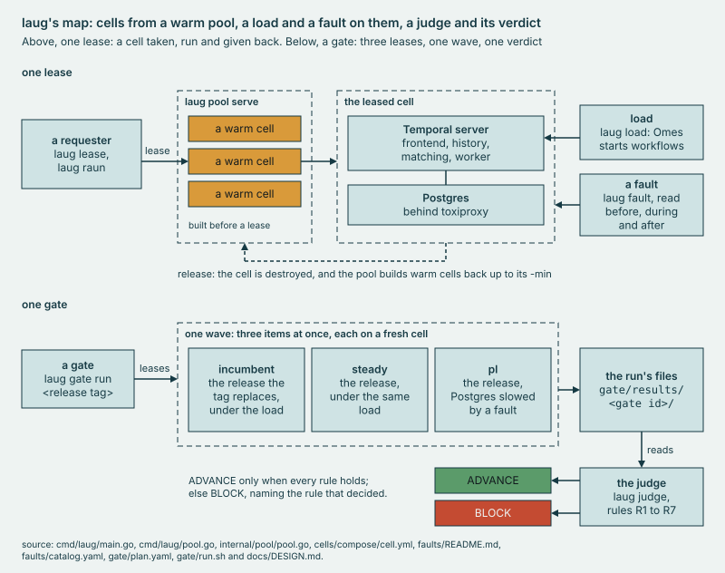

<p align="center"><picture>
  <source media="(prefers-color-scheme: dark)" srcset="docs/brand/laug-wordmark-dark.svg">
  
</picture><br><a href="https://github.com/ymur-studio/laug/actions/workflows/test.yml"></a></p>

<p align="center"><b>Ephemeral Temporal cells from a warm pool, for release validation.</b><br>
<code>ADVANCE</code> 30 of 30 gates of a release against itself<br>
<code>BLOCK</code> 3 of 3 gates with 25 µs added to every packet into the release's Postgres</p>

laug (Old Norse for a warm pool, pronounced loyg) keeps Temporal cells warm and leases one in seconds. A cell is a
complete Temporal server with its own Postgres database.

`laug gate run` puts a new server release beside the one it replaces, each on a fresh cell under the same steady load,
adds the new release under a planted fault on a third cell, and returns ADVANCE or BLOCK. The verdict is worked out
from the run's files, so any committed gate run can be judged again.

laug is independent: not affiliated with, sponsored by or endorsed by Temporal Technologies Inc.



*Top: one lease from the warm pool. Bottom: one gate. The old release, the new one, and the new one under a fault each
get a fresh cell and run at once, then the judge gives the verdict.*

## Try it in five minutes, no Docker

```sh
make build; bin/laug deps -offline      # the binary, then the offline path's tools checked
bin/laug gate run 1.31.0 -fake          # a whole gate on fakes: ADVANCE, exit 0
bin/laug gate rejudge g20261018-092540  # a committed BLOCK, judged again, byte for byte
```

Linux, Go 1.26, jq 1.7 or later, yq v4 (mikefarah/yq), bc and ss. [Runbook 1](docs/runbooks/1-offline.md) lists the rest
and takes the long walk. Its `make test`: about 5 minutes on the lab host (`cells/results/2026-10-24-boot4.txt`:168).

## The words

Temporal's words keep Temporal's meaning: workflow, activity, worker, event history, namespace, task queue, shard, and
**cell**, one complete deployment with its own database; here, on one host. laug adds eight:

- **pool**: the cells kept warm. `laug pool serve` runs it; step names, logs and records call that process laugd.
- **lease**: take a cell for one job, then give it back.
- **raun** (Old Norse: a trial): one fault on one leased cell, read before, during and after it.
- **gate**: judges one release by several items in one wave, each item on a cell of its own.
- **item**: one thing a gate runs: the new release under a steady load, the new release under a fault, or the incumbent.
- **wave**: the items of one gate, run at the same time on the same host.
- **incumbent**: the release being replaced, run beside the new one. An A/A gate runs a release beside itself.
- **verdict**: ADVANCE or BLOCK, a function of the run's files. `laug gate rejudge` computes it again.

## What it showed

On the lab host, an m8i.8xlarge (32 vCPU, 128 GiB): one host type, one load, one store, one history process in each
cell. The limits, and every number's record, are in [CAPABILITIES](docs/CAPABILITIES.md).

- A warm cell leases in 1 ms at p95. With the pool drained, a cold lease takes 17.5 s on compose and 7.6 s as a jailed
  microVM restored from a snapshot, nested on EC2.
- A gate hands its verdict 612.5 to 614.3 s after it starts, in 4 gates. With its worker killed 60 s or 300 s into the
  wave, the next worker handed the same verdict, 612.8 and 614.2 s in.
- 30 of 30 gates of a release against itself ADVANCEd, which bounds the false-BLOCK rate at 9.5% with 95% confidence.
- 25 µs of delay on every packet into the release's Postgres BLOCKed 3 of 3 gates while every fixed limit held.
- Two releases judged A/B on the same load differed by up to 0.401 ms of persistence p99. The reading sums every
  persistence operation and every role, and 1.32 changed the mix, so it may be a change of mix rather than of speed;
  the files do not say. It sits at the edge of the 0.35 ms tolerance: 1 of the 3 judged gates BLOCKed.

## What it does not prove

- Another host type: a gate on cells judges by the lab host's maxima and refuses another type; measuring a set for
  yours is in [load/baseline.md](load/baseline.md#a-set-for-a-new-host-type). One cell, one load and one verdict on
  your own host, with Docker: [runbook 2](docs/runbooks/2-lease-and-load.md).
- Another load or store: one scenario of Omes (temporalio/omes, Temporal's load generator), 5 min at 20 workflows/s
  with 50 in flight, on Postgres, on one Linux host (`gate/plan.yaml`).
- Shard movement between history processes, or a membership change beyond a role's restart: each cell runs one
  history process.
- An upgrade in place, Multi-Cluster Replication, a region failure, or a verdict posted on a pull request.
- Several namespaces or tenants on one cell, or recorded production traffic: one namespace, one synthetic scenario.
- The first gates after a boot, one start of the lab host: 4 BLOCKs in 63 A/A gates to boot 6, each a host's first or
  second gate (`cells/results/2026-10-27-boot6.txt`:445). A boot's runs are a batch, and a batch opens with a warm-up.

## What's next

Next to build: an upgrade in place as a gate item; several history processes in a cell, so a shard can move and
membership can change; and a fourth item, the incumbent under the same fault as the new release, so a release that
degrades worse under it cannot ADVANCE on clean recovery alone. The learning page's
[What's next](docs/LEARNING.md#whats-next) has the rest, with the ten questions its 19 stops leave open.

## The tree

- [`cells/`](cells/README.md): how a cell is built, on compose or as a Firecracker microVM restored from a snapshot.
- [`load/`](load/README.md): the steady load, an Omes scenario on one cell, and the verdict on it.
- [`faults/`](faults/README.md): the fault catalog, one row a fault, which `laug fault` and `laug raun` run on a cell.
- [`gate/`](gate/README.md): `laug gate run`: its plan of three items, its steps, the controls a gate must catch.
- [`internal/`](internal/): laug's Go packages, among them the pool, the judge, the rejudge and the Gate workflow.
- [`cmd/laug/`](cmd/laug/): the `laug` binary; `bin/laug help` lists its commands.
- [`docs/`](docs/): the pages, the runbooks, the figures and the summary tables of the committed records.
- [`dashboards/`](dashboards/README.md): what each cell's Grafana loads: its Prometheus datasource and the gate board.
- [`check/`](check/): the tree's own tests: pages, results, records, shell files and the CI file.
- [`_report/`](_report/): the renderer, a Go module of its own; `make docs` runs it to write the figures and tables.
- [`_obs/`](_obs/README.md): the observability stack and its verbs, `bin/obs`: a Go module of its own. No gate needs it.
- [`.github/`](.github/workflows/test.yml): the CI job: the offline path on a fresh clone, no Docker.

Each `results/` under `cells/`, `load/`, `faults/` and `gate/` holds records laug wrote ([RECORDS](docs/RECORDS.md)).

## Read on

[LEARNING](docs/LEARNING.md): Temporal in 19 stops, each with its readings. [CAPABILITIES](docs/CAPABILITIES.md): what
laug does and its limits. [DESIGN](docs/DESIGN.md): the design. [EVIDENCE](docs/EVIDENCE.md): each gate run.
[SECURITY](SECURITY.md): every listener.

**Sending a change.** laug is published in snapshots, each run through `make test` first, so there is little
history here and no development branch. An issue that names the record you read and what it should say helps most.
A patch is welcome, as a pull request or a diff in an issue; it lands in the next snapshot with you as its author.
`make test` runs everything; a failure says what broke and where.

## License

laug is under the Apache License, Version 2.0 ([LICENSE](LICENSE)). Seven files from temporalio/samples-server and
temporalio/temporal keep their MIT License, each with its source in [THIRD_PARTY_NOTICES.md](THIRD_PARTY_NOTICES.md).
