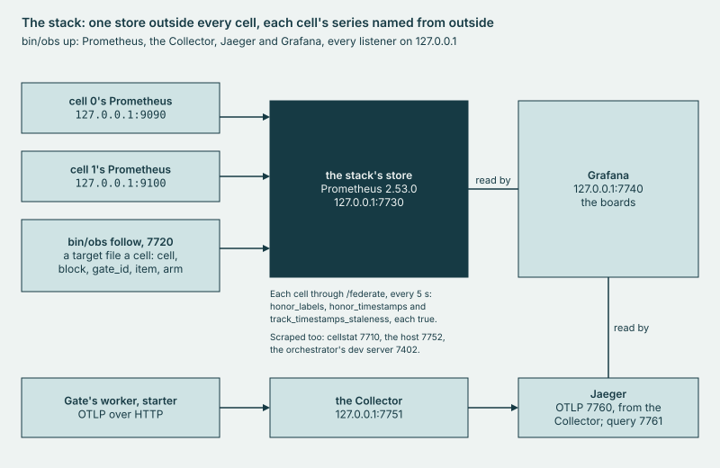

# _obs

_obs receives what laug emits, its traces and metrics, in one observability **stack** that the gate never needs.

## Why

Each cell's own Prometheus goes with the cell, so without _obs a cell's series end at its release, and a gate run as a
Temporal workflow sends its traces nowhere. One store outside every cell keeps each leased cell's series, under labels
that outlive it, and each gate's files as series; Jaeger keeps the traces, and Grafana reads both. The stack judges
nothing, listens on 127.0.0.1 alone because nothing here has auth, and stays down while a gate runs, since it failed its
noise rule on CPU.



*One store outside every cell, each cell's series named from outside.*

## Use

```sh
bin/obs up
bin/obs backfill
bin/obs find <gate id>
```

The first fetches the releases `_obs/versions.txt` pins, checks each one's size and sha256, and starts the stack; its
first line says `bin/obs down` stops it. The second puts the gate runs under `gate/results/` that the store lacks into
it, at their own times. The third prints a gate's board and trace links and what the store holds of it. The first two
refuse while a gate runs; the third only reads. `bin/obs help` prints the rest, and `make obs-test`, outside
`make test`, is the stack's own test.

## Extend

- **A board**: a JSON file under `_obs/stack/`, which the stack's Grafana loads read-only at the next `bin/obs up`.
  `make lint` holds it to `_obs/lint.sh`'s board rules, and [dashboards/README.md](../dashboards/README.md) says what
  they ask of a board's author.
- **A part**: its name in `PARTS`, a row in each table beside it (`TABLE`, `RELEASE`, `BINARY`, `ANSWER`), a case in
  `start_part`, its ports in `PORTS` and its config in `CONFIGS`, all in `_obs/obs.sh`. Its release is a line of
  `_obs/versions.txt`, with size and sha256. `make obs-test` refuses an address in a config of `CONFIGS` that is not
  127.0.0.1 or a port outside `PORTS`, and [SECURITY.md](../SECURITY.md)'s listener table names each listener.
- **A verb**: a row of the table in `_obs/cmd/obs/main.go` and its paragraph in `_obs/cmd/obs/doc.go`, in _obs's own
  module, which `make build` builds as `bin/obs`. `TestTableRules` and `TestBareByClass`, in `make test-go`, hold it.

## Evidence

[CAPABILITIES, Observability](../docs/CAPABILITIES.md#observability); the runs in [`cells/results/`](../cells/results/).
