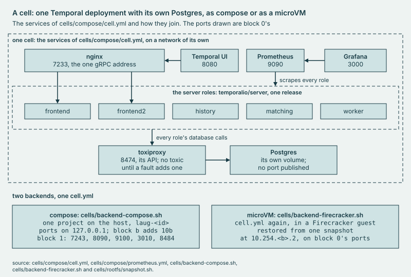

# cells

How a **cell** is built: one compose file, the two backends the pool drives, and the checks that show a cell serves.

## Why

Without a fresh cell, a suite runs on a server that outlives it and inherits whatever the last suite left in it. A
cell here is one whole Temporal deployment, every role a process of its own, with its own Postgres behind toxiproxy so
a fault reaches persistence without touching the server. Two cells share a host, so each takes its ports from a block
the pool hands it, and by default only this host reaches them, since nothing in a cell has auth.
[SECURITY's listener table](../SECURITY.md#listeners) gives each listener's ports, its default bind and what widens
it, if anything; the same page says that `bin/laug pool down -remove-cells` is host-wide.



*One cell.yml, two backends: a compose project on the host, or a microVM restored from a snapshot.*

## Use

```sh
bin/laug cell up
bin/laug cell health
bin/laug cell down
```

The first brings one cell up on this host and waits until it serves; `-server-tag` picks another release and
`-visibility es` puts visibility on Elasticsearch. The second checks it end to end: the Temporal CLI's cluster
health, one HealthCheck workflow found in visibility, and every server role up in the cell's Prometheus. The third
lists what would go, and with `-remove-volumes` removes the cell and its data. A pool's cells come from
`bin/laug pool serve`, as [runbook 2](../docs/runbooks/2-lease-and-load.md) walks.

## Extend

- **A backend**: a script that `bin/laug pool serve -backend <script>` runs as `<script> create|destroy|health <id>`,
  with the cell's port block in `LAUG_BLOCK`. Its create prints the cell's JSON, the fields of `Cell` in
  `internal/pool/pool.go`. The pool runs one verb more, `vmfault`, for POST /vmfault, and the compose backend refuses
  it. The Firecracker backend has others that the pool never runs, such as `prep`: before the pool starts,
  `bin/laug pool serve -backend firecracker` runs it. `TestScriptEnvAndStderr` and `TestPoolServeBackend` hold what
  the pool hands a script, and `make harness-test` runs `cells/backend-compose.sh` on fakes and holds its JSON.
- **A role or an image**: a service in `cells/compose/cell.yml`, its image on an exact tag as every image but
  Postgres's is, its entry in `cells/compose/cpus4.yml`, and for a server role a target in
  `cells/compose/prometheus.yml`. `make harness-test` holds `cpus4.yml` to every service of `cell.yml`, and the server
  and admin-tools images to one default tag. A microVM cell runs what its image baked, so run `make fc-image` and
  `make fc-snapshot` again, as [the rootfs page](rootfs/README.md) walks.
- **A server release**: `-server-tag` on `bin/laug cell up` or `bin/laug pool serve`. Server fault injection runs on
  `cells/compose/config/laug-server.yaml`, vendored from one release. A serverfi fault refuses a cell on any other
  tag until the file is vendored again. `bin/laug cell fi-template-check -server-tag <tag>` compares the file with
  that release's template, as [runbook 6](../docs/runbooks/6-add-a-fault.md) says for a serverfi row.
  `bin/laug cell dynconfig-check -template -server-tag <tag>` checks the dynamic config's keys with that release's own
  validator.

[DESIGN, Cell anatomy](../docs/DESIGN.md#4-cell-anatomy) is the design these follow.

## Evidence

[CAPABILITIES, The pool](../docs/CAPABILITIES.md#the-pool); the runs in [`cells/results/`](results/).
