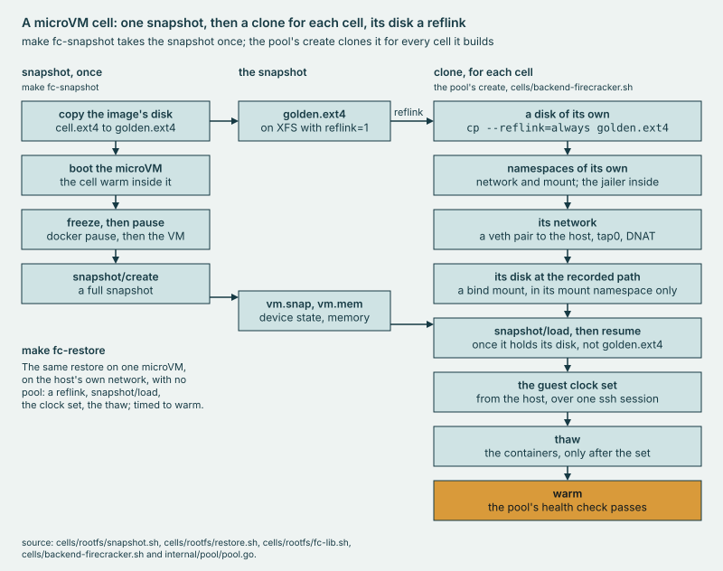

# cells/rootfs

The microVM cell's image and its **snapshot**: one cell warmed inside a Firecracker microVM, then cloned for every cell
the pool builds.

## Why

Without a snapshot, every microVM cell would boot Docker and the whole cell from cold, then wait to be warm. So one
cell is booted and warmed once, frozen and snapshotted, and each clone restores that memory onto a disk that shares the
golden disk's blocks. Every clone wakes as the same machine, its clock stopped at the pause, so each gets namespaces of
its own and the host's clock before its containers thaw.



*make fc-snapshot takes one snapshot; for each cell, the pool's create restores a clone of it on a reflinked disk.*

## Use

```sh
sudo make fc-image
sudo make fc-snapshot
sudo make fc-restore RESTORES=3
```

Each needs Linux x86_64 with `/dev/kvm` and runs as root; build `bin/laug` first as yourself with `make build`. The
first builds the cell image, the second warms a cell in a microVM and snapshots it, and the third restores it
`RESTORES` times, each timed to warm. They refuse while a Firecracker pool is up.

Besides their files under `$FC_DIR` (`/opt/fc` unless set) and `FC_DISKS`, the three leave on the host what nothing here
undoes. `net_up` in `fc-lib.sh` leaves `tap0`, IP forwarding on, two FORWARD rules that pass only `tap0` to the uplink
and its replies, and a MASQUERADE rule for the guest's subnet. `disks_up` in `fc-lib.sh`, run by `fc-snapshot` and
`fc-restore`, leaves nothing if `FC_DISKS` is a mount point. Otherwise it installs `xfsprogs` with apt-get if `mkfs.xfs`
is missing, and loop-mounts `$FC_DIR/disks.xfs` there. `build-image.sh`, run by `fc-image`, pulls each cell image Docker
lacks. [SECURITY.md](../../SECURITY.md#firecracker-and-root) says what reaches the one guest they boot.

## Extend

- **The image**: `build-image.sh` fetches Firecracker, its jailer, a guest kernel and rootfs at the versions and sha256
  sums `fc-lib.sh` pins. It installs the guest's packages and the cell's files and makes new ssh host keys. After a
  change run `make fc-image`, then `make fc-snapshot`: `fc-restore` and the pool refuse a snapshot older than the image.
- **The snapshot's knobs**: `VCPUS` and `MEM_MIB` size the guest, and `FREEZE=0` skips the containers' freeze.
  `FC_CACHE_TYPE`, the drive's cache mode, is Writeback unless set, and stays as the snapshot took
  it.<!-- source: Firecracker v1.17 swagger, PartialDrive --> `FC_DIR` and `FC_DISKS` place the files and the disks.
- **The pool's backend**: `cells/backend-firecracker.sh`, the contract of [the cells page](../README.md) plus the verbs
  its opening comment lists. `sudo bin/laug pool serve -backend firecracker` runs `prep`, then serves cells, each VMM
  jailed unless `FC_JAIL=0`. `sudo bin/laug pool down -backend firecracker -remove-cells` stops the pool and runs
  `sweep`, which removes what it left. `vmfault` serves a `vm` fault row
  ([runbook 6](../../docs/runbooks/6-add-a-fault.md)). `make harness-test` holds the scripts on fakes, with no KVM and
  no root: their syntax, the knobs' refusals, each download's sha256 check, the jailer's argv, the freeze and the thaw.
  [Runbook 7](../../docs/runbooks/7-lab-batch.md) runs a lab batch on microVM cells.

[DESIGN, A microVM cell](../../docs/DESIGN.md#43-a-microvm-cell) is the design these follow.

## Evidence

[CAPABILITIES, The pool](../../docs/CAPABILITIES.md#the-pool); the runs in [`cells/results/`](../results/).
