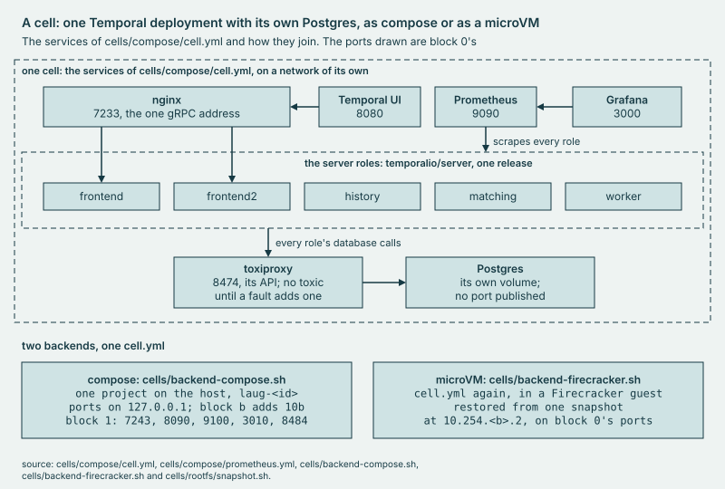
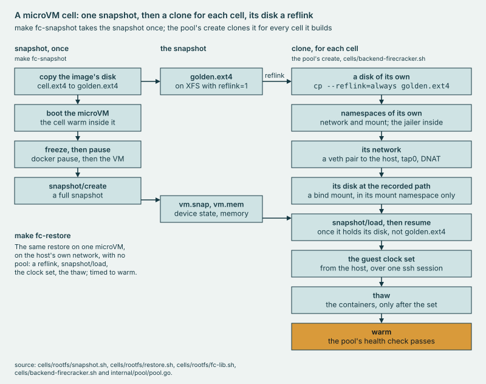

# check/testdata/readme-clean

A planted **README** that keeps every rule of the directory contract, in the forms the rules let through.

## Why

Without it, a rule could pass on every page and never be seen to fail. Each plant beside it breaks one rule, and the
test reads them all through one function. This one breaks none, so a rule that grows too wide fails here first.

<!-- source: server v1.31.0 -->

*A caption may count: 2 backends, 1 cell.*

## Use

```sh
bin/laug cell up -server-tag 1.31.0
bin/laug cell health
make fc-restore RESTORES=3
```

[Runbook 2](../../../docs/runbooks/2-lease-and-load.md) walks it. R6 checks the host type, sha256 sums pin each
download for x86_64, `FREEZE=0` skips the freeze, and the stack listens on 127.0.0.1 alone.



*The snapshot takes 4 steps, once, and each clone 8.*

## Extend

| Seam | Test |
| --- | --- |
| a directory | one line of `readmeDirs`, held by `TestReadmes` |

## Evidence

[CAPABILITIES, The pool](../../../docs/CAPABILITIES.md#the-pool); the runs in [`cells/results/`](../../../cells/results/).
