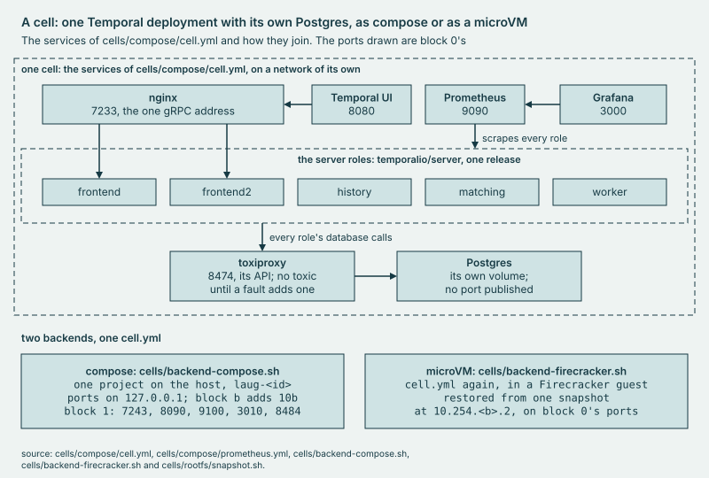

# dashboards

What each cell's **Grafana** loads when the cell starts: the cell's Prometheus as its datasource, and the gate board.

## Why

A load's verdict reads its cell's Prometheus with `load/steady-state.yaml`'s queries, so a board with a near copy of one
shows a reading no verdict judged. Each cell's Grafana starts with the gate board, which draws each of the yaml's maxima
with its query, and `make lint` fails it when either drifts. It reads no verdict, so it shows no ADVANCE or BLOCK.



*Each cell's Grafana reads that cell's Prometheus alone, and loads the files here.*

## Use

```sh
bin/laug cell up
bin/laug lease
make lint
```

The first brings one compose cell up on this host; its last line says where its Grafana answers, with no login and by
default on this host alone. The second leases a cell from the pool that `bin/laug pool serve` runs, as
[runbook 2](../docs/runbooks/2-lease-and-load.md) walks, and prints the lease, whose `grafana` field is that cell's
Grafana. The third holds the gate board and every stack board to `_obs/lint.sh`'s rules, and their timezone to UTC.

## Extend

- **A board for every cell**: a JSON file beside `gate.json` in `provisioning/dashboards/boards/`, which `boards.yml`
  loads into the folder `laug`, its queries on the uid `laug-prometheus` of `provisioning/datasources/prometheus.yml`. A
  compose cell mounts `provisioning/` read-only; a microVM cell has the copy its image baked, so run `make fc-image` and
  `make fc-snapshot` again. `make lint` reads `gate.json` alone of the boards here. Temporal's server and SDK boards,
  [temporalio/dashboards](https://github.com/temporalio/dashboards), would go here; none is imported yet.
- **A threshold**: a new max goes in `load/steady-state.yaml` and `gate.json` together; a new query, in those and in
  every stack board that draws the row, or the lint fails. The board's colors are [docs/BRAND.md](../docs/BRAND.md)'s:
  water for the series and for the stat under its max, ember for the max lines and for the stat at or over it.
- **A board for the stack**: a JSON file under `_obs/stack/`, never under `provisioning/`, which every cell mounts;
  [_obs/README.md](../_obs/README.md) says how the stack loads it. The lint asks, as `_obs/lint.sh`'s header says:
  - A query that draws a row of `load/steady-state.yaml` takes the row's name as its refId, and one that draws a fault's
    signal in `faults/catalog.yaml` the fault's. Each is that query with exactly one label matcher added. A query under
    another refId that reads like a row is held to the same string; a rolling line groups by item, cell or arm.
  - A max is `laug_threshold` for the gate on screen, never a typed number, so a board weeks later draws the bar that
    gate was judged by. The gate board types its maxima, since a cell's Prometheus has no `laug_threshold`.
  - ADVANCE and BLOCK appear only in a panel that reads `laug_gate_verdict` or `laug_gate_rule`.
  - An annotation of a `*_seconds` value turns it to milliseconds, the unit Grafana reads it in. No `or vector(0)` sits
    beside a `by (`. A quantile sums `by (..., le)`, with item, cell or arm in it when it can hold more than one cell.
- **The habits the lint does not check**: a graph draws one unit, never two y axes, and a stat or table of more than one
  unit names each. On the gate run and raun boards, a panel's title says its source: record, the gate's files, or store,
  a cell's federated series. A hidden cell variable is a `query_result` that answers `none` when the gate has no such
  cell. A matcher on it then never selects the series with no cell label, the dev server's among them. A board that
  declares `schemaVersion: 39` gets no migrations, so a timeseries panel in the old `legend: {displayMode: hidden}`
  shape renders empty with no error: write the full `options.legend` and `fieldConfig.defaults.custom`.

## Evidence

[CAPABILITIES, Observability](../docs/CAPABILITIES.md#observability), where `make obs-test` lints the boards.
