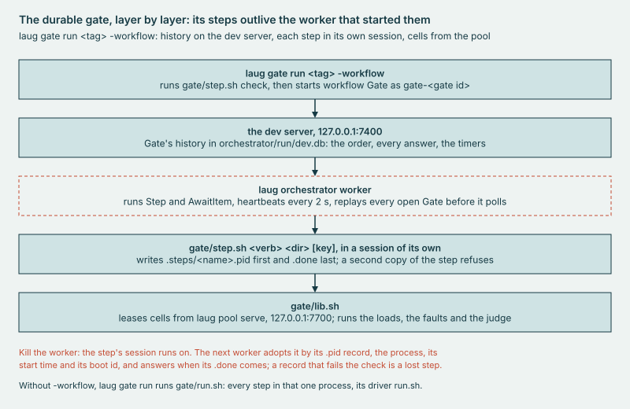

# Learning Temporal by building a release gate

laug is independent: not affiliated with, sponsored by or endorsed by Temporal Technologies Inc.

Temporal calls it Durable Execution: a promise that your code will finish, even when the machine running it doesn't. It
keeps that promise by recording every step a workflow takes, so another machine can pick up where the last one stopped.
I wanted to learn how a release is checked against that promise, from the inside, under load and when things break.

laug (pronounced loyg) is Old Norse for a warm pool, the kind the ground keeps hot. laug keeps throwaway Temporal
servers warm, loads them, breaks them on purpose and returns a verdict on each release. Every cell here ran on one host,
with one history process and one Postgres.

## Before you start

There are 19 stops in 7 parts. Each stop opens with its claim and ends with the idea to keep. The fold under each stop
holds the exact readings, the files they came from and the commands that reproduce them.

If you run Temporal servers, stops 3 to 7 and 9 to 12 are the ones to check against your own setup. If you write
workflows, start with stops 1, 2 and 16 to 18.

**Try it.** In a clone of [github.com/ymur-studio/laug](https://github.com/ymur-studio/laug), three commands build laug,
run a gate on fake cells and judge a stored one again, with no Temporal server and no Docker, on Linux with Go, jq and
yq v4 installed; [runbook 1](runbooks/1-offline.md) lists the rest.

    make build
    # a whole gate on fakes: ADVANCE, exit 0
    bin/laug gate run 1.31.0 -fake
    # a committed BLOCK, judged again, byte for byte
    bin/laug gate rejudge g20261018-092540

**The numbers.** Every reading comes from a result file in the repository, except a few from the dev host. The runs fall
between October 13 and November 2, 2026. Unless a stop says otherwise, a run used the lab host on AWS and Temporal
server 1.31.0; laug's own code used Go SDK 1.49.0. Apart from stop 7's one-minute test at Omes's own rate, every load
the stops read ran at 20 workflows a second with at most 50 in flight, against one history process and one Postgres, on
one host; with one history process there is no shard movement between hosts and no membership change beyond a role's
restart. A boot is one start of the lab or metal host; its runs are a batch. A range such as "5 to 6 seconds" is the
spread of the repeated runs, usually 3; it is not a confidence interval. A footnote marks a claim read in source or
documentation, not run. In the folds, a figure worked out from other readings says what it was worked out from. What I
concluded without measuring it is listed in [What I assumed](#what-i-assumed). laug's own report generator draws every
figure.

| Host | Stops |
|---|---|
| the lab host, an m8i.8xlarge (32 vCPU, 128 GiB) | every stop, unless it says otherwise |
| the first lab host, an m8i.2xlarge (8 vCPU, 32 GiB) | 4 and 6 |
| the metal host, an m8id.metal-48xl (192 vCPU, 768 GiB) | 8 and 9 |
| the dev host, a Linux VM with 24 vCPU and 47 GiB running Docker | 6 and 14, from records kept outside the repository and quoted in committed files |

**What it stands on.** Temporal's own tools do much of the work. Omes, Temporal's load generator, drives the load. The
Temporal CLI, `temporal`, checks the servers. `tdbg`, Temporal's debug tool, and the server's own fault injector supply
some of the faults. Toxiproxy, Firecracker and Prometheus do the rest.

**The words.** Temporal's words first, then laug's own. laug's commands and runbooks use the same words.

*Temporal's words*

- **Workflow**: the code Temporal keeps running. It must make the same decisions every time it runs, because Temporal
  rebuilds its state by running it again.
- **Activity**: a step inside a workflow that does real work, such as calling a service. An activity can fail and be
  retried; the workflow records its result.
- **Worker**: your process, which asks the server for work and runs workflow and activity code.
- **Event history**: the server's record of everything one workflow did.
- **Frontend, history, matching**: three of the server's roles. The frontend takes every call, history writes events
  and runs timers, and matching hands tasks to workers.
- **Shard**: a slice of the workflows. Each history process owns some shards, and only the owner may write to them.
- **Cell**: one self-contained Temporal deployment with its own database, as Temporal Cloud uses the word.[^s0] laug's
  cells are throwaway Temporal servers, each on one host with its own Postgres.

*laug's words*

- **Pool**: the cells laug keeps warm and ready; `bin/laug pool serve` runs it.
- **Lease**: take a cell from the pool for one job, then give it back.
- **Raun** (Old Norse for a trial): one fault on one leased cell. laug loads the cell, injects the fault, reads the
  windows before, during and after it, and judges the result.
- **Incumbent**: the release being replaced, run beside the new one under the same load.
- **Gate**: judges one release by several items at once, each on a cell of its own, in one wave.
- **Item**: one thing a gate runs: the new release under a steady load, the new release under a fault, or the
  incumbent.
- **Wave**: the items of one gate, run at the same time on the same host.
- **A/A and A/B**: a gate is A/A when the new release and the incumbent are the same release, and A/B when they
  differ. The new release and the incumbent are the gate's two arms.
- **Verdict**: what laug returns for a load, a raun or a gate: ADVANCE (ship it) or BLOCK (don't).

Where a process is *killed*, it was stopped abruptly, with no chance to clean up. A *p99* is the 99th percentile: 99
requests in 100 took no longer than this.

## Part 1 · How Temporal runs your code

This part is Temporal's own model, seen through one small workflow: who writes the history, and what a deploy replays.

### 1. The server writes every event; the worker only proposes

A worker never writes a workflow's history. It runs your code and proposes the next commands, and the server decides
what is recorded.

One small test workflow, HealthCheck, ended with 24 events. The worker asks for work, runs the code until it has to
wait, and replies with commands such as "start this activity" or "set a timer". History turns the commands into events.

*The worker proposes and history records. Below, HealthCheck's 24 events, with its four bursts, the signal and the two
timers marked.*

Three things follow:

- **The code runs in bursts**: 4 for HealthCheck, one for each workflow task.
- **A signal sent before the code is ready is kept** until the code reads it.
- **Timers live in the server.** I killed a worker partway through a 60-second timer. The timer fired on time, and a
  second worker finished the workflow.

One surprise: waiting for a signal with a 30-second timeout started the timer even though the signal had already
arrived. The Go SDK has a change that skips the timer when the signal is already there. It sits behind a flag that is
off by default in 1.49.0 and still off in 1.50.0.[^s1]

**The idea**: code that does real work belongs in an activity, and workflow code must make the same decisions every
time, because it will be run again.

Readings and sources

- The 4 bursts completed at events 5, 11, 17 and 22. The signal is event 3. The timers are events 18 and 23.
- The worker was killed 20 s after arming a 60 s timer. By the server's events, the timer fired 60.003 s after it
  started, 0.063 s late by the host's clock.
- **Evidence**: jq `.events[].eventType` over `internal/health/testdata/healthcheck_history.json`, a copy of one
  HealthCheck recorded on a live cell (`cells/results/2026-10-23-boot1.txt`, A9e and A9f); the killed worker, A9b to A9d
  in the same file, and its history's timer events, `cells/results/2026-10-23-boot1.txt`:287.
- **Try it**: `bin/laug health replay` runs the replay tests with no server. On a cell from
  [runbook 2](runbooks/2-lease-and-load.md), `bin/laug health timer 60s` arms one timer and reports when it fired.

### 2. A deploy is a replay

When you deploy new workflow code, each open workflow is replayed on it at its next workflow task, and replay fails if
the new code issues different commands. Under Worker Versioning, a Pinned workflow is the exception: it stays on the
Worker Deployment Version it started on, and a new build takes it only when an operator moves it.[^s1b]

To resume a workflow, a worker runs the code from the top and feeds it the recorded events instead of redoing the work.
The Go SDK checks that the code issues the same commands in the same order. It compares each command's type and ID,
never its values.[^s1a]

*Determinism means the same commands in the same order. Everything in the right-hand box can change freely.*

Of nine changes to HealthCheck, five replayed cleanly. The four that changed which commands run, or their order, failed.

A failure doesn't always point at its cause. Results are matched by ID, so a build with two activities swapped hands one
activity's result to the other before any name is checked. The error appears at event 12, where the code runs out of
commands to match, not at event 6, where the mix-up began.

*The swapped build fails at event 12, where no command is left to match.*

My replay test once couldn't fail at all. I had piped `go test` into `grep` without `pipefail`, so the build only ever
saw grep succeed. Every recipe in the Makefile sets `pipefail` now.

**The idea**: keep a replay test against real recorded histories, and check that it can fail.

Readings and sources

- The four failing changes fail with TMPRL1100, the Go SDK's nondeterminism error. The Makefile sets
  `.SHELLFLAGS := -o pipefail -c`.
- **Evidence**: TestReplayChanges in `internal/health/changes_test.go` (9 of 9) and TestReplayDetectsSwappedActivities
  in `internal/health/replay_test.go` (TMPRL1100 at event 12) replay
  `internal/health/testdata/healthcheck_history.json`, a copy of the HealthCheck stop 1 counts, recorded on a live cell
  (`cells/results/2026-10-23-boot1.txt`, A9e and A9f).
- **Try it**: `go test ./internal/health -run TestReplay -v`, or `make test-go`, which runs them with the rest.

## Part 2 · Inside a cell

This part is Temporal's server as laug runs it: what its signals prove, and what a restart, a cold start and a config
change cost.

### 3. Answering is not working

A Temporal server reports healthy seconds before it can run a workflow. Only a completed workflow proves the whole
path works.

A cell has four roles (frontend, history, matching and an internal worker) and two databases. laug runs the roles as
five processes, with two frontends. History splits workflows into a fixed number of shards. Each shard has one owner,
which proves ownership with a fenced range ID: a counter that stops an old owner from writing after a new one takes
over.[^s2a] The default image uses 4 shards; laug uses 512.

*laug's warm check, timed. On fresh cells the shards were owned before the frontend answered; with every shard
refused, the frontend still said SERVING.*

On fresh cells, counting from the start of `bin/laug cell up`, history owned its shards at about 10 seconds, and the
frontend's health check answered at about 14. The first workflow then failed to start, with "Namespace default is not
found", though the namespace had answered a describe a moment before, which reads as a frontend's namespace cache still
catching up. The second completed by about 17 seconds.

With history refusing every shard, the health check still said SERVING about 6 seconds after history started, while
the cell owned no shards at all. That's by design. History's own health check waits for its shards,[^s2] but the
frontend's, the one you usually ask, reports only on the frontend.

A gauge of owned shards has the same trap: a history that's down reports no data at all, so an alert must treat "no
data" as down.

**The idea**: each readiness signal proves one thing, and only a completed workflow proves the whole path works.

Readings and sources

On three fresh cells, history logged its 512 shards ready 10.3 to 10.4 s after `bin/laug cell up` began, and
`temporal operator cluster health` and the namespace answered at 13.8 to 14.4 s. The first HealthCheck failed with
`Namespace default is not found`; the next completed at 16 to 17 s, a time the first item below works out.

- The 16 to 17 s: a HealthCheck's workflow ID holds its start in Unix milliseconds (`internal/health/check.go:136`), and
  it completed 1,111 to 1,140 ms later
  (`docs/tables/quotes.jsonl#cells/results/2026-10-23-boot1/extra/a4-health-1.txt:15`,
  `docs/tables/quotes.jsonl#cells/results/2026-10-23-boot1/extra/a4-health-2.txt:14` and
  `docs/tables/quotes.jsonl#cells/results/2026-10-23-boot1/extra/a4-health-3.txt:15`). The zero is history's shards line
  less the 10.3 to 10.4 s (`docs/tables/readings-2026-10-23-boot1.jsonl#A4/ready_1` and the two after it). A4 itself
  records 24.5 to 24.9 s: when `bin/laug cell health` returned, which waits after the workflow until Prometheus has the
  5 server targets up (`cells/health.sh`).
- With every shard refused, one cell answered SERVING at its second poll, 5.3 to 6.3 s after history started (polls
  stamped to the whole second), and logged 1,299 failed acquires by its last poll, after its 150 s cap. The warm check
  reads the shard log only since the container's last start, because a restarted container keeps the old lines.
- **Evidence**: `cells/results/2026-10-23-boot1.txt`, A3 (4 shards, by history's line and the shards table), A4 (the
  fresh cells) and A7 (SERVING, 0 shards); the 512 in `cells/compose/cell.yml`; the check in `cells/backend-compose.sh`
  and `cells/shards-ready.sh`; "no data" read as down in kill-history's `signal_query`, `faults/catalog.yaml`.
- **Try it**: `bin/laug cell up`, then `bin/laug cell health`. [Runbook 2](runbooks/2-lease-and-load.md) leases a cold
  cell instead, from a pool that holds one at most and keeps none warm.

### 4. A restart costs more than it shows

Restart history and the server recovers within a second, but clients still see failures into the 12th second after it.

With history killed under load, nothing completes. Restarted, it owns all 512 shards again in about half a second, and
laug's recovery signal, polled every 5 seconds, reads clear 5 to 10 seconds after the restart. Clients see more. While
history was down, their starts failed in bursts of 49, 10 seconds apart. After the restart, 44 to 51 more failed, almost
all in the first 4 seconds, the last up to 12 seconds after it. That burst reads as the tail of the outage: starts sent
while history was down, each failing as its 10-second deadline ran out.

*The dashed line is the restart. The last burst, just after it, is what clients still felt.*

On the first lab host, my first verdict window opened the moment the signal cleared. In 1 raun of 3, starts were still
failing at their deadline, and the verdict called that a regression. laug now waits 30 seconds after recovery before
that window opens. It records the starts that fail from the restart until then, and they don't decide the verdict.

**The idea**: recovered for the server is not recovered for its clients. Measure both.

Readings and sources

- History was held down 120 to 121 s at 20 workflows a second, each raun on a cold lease. 545 to 551 starts failed
  during the hold and 44 to 51 in the window from the restart to the after window, which ran 35 to 40 s; the after
  window counted 0. The shards were back 0.5 to 0.6 s after the restart.
- In the hold, each burst held 49 over 3 or 4 seconds, 10 s apart, and from about a minute in, 1 more failed midway
  between bursts. Counted from the failed starts by second, each second floored, 43 to 49 failed in the first 4 s after
  the restart, and the last at +4 to +11 s. One raun's burst began 1 s before the restart, with 6.
- A raun keeps at most 50 starts in flight, and a start's client deadline is 10 s, so 49 failing every 10 s fits starts
  that each wait out their deadline. The bins keep no error message, so on the lab host no log names the deadline; the
  first window's load log does.
- Three earlier rauns on the lab host, with the same 30 s wait, counted 63 to 97 failed starts in the same window, 35
  to 36 s long, and timed none of them. The files don't say why they hold more.
- My first verdict window, on the first lab host, opened at the first poll that read clear. That was 6 s after the
  restart in the raun that BLOCKed, and 10 s in the 2 that ADVANCEd. The BLOCKed raun's load log shows outage starts
  failing at their deadline inside that window. With the 30 s wait, the next 3 ADVANCEd.
- **Evidence**: `cells/results/2026-10-27-boot6.txt`, A4, with `faults/results/raun-lab6-kill-history-{1,2,3}.json`
  (`.iterations_failed`, `.history_shards_ready_s`, `.time_to_recover_s`) and the failed starts by second,
  `docs/tables/fig-kill-history.jsonl#raun-lab6-kill-history-1/` and the two beside it (`.s`, `.n`); the 50 in flight,
  `-max-concurrent` in `cmd/laug/doc.go`; the 30 s, `settle_s` in `faults/catalog.yaml`, which names the 10 s deadline;
  the restart's window, recorded and not judged, `faults/README.md`, The three windows; the earlier rauns,
  `docs/tables/records.jsonl#cells/results/2026-10-17-lab-kill-history.txt` and the rows of
  raun-lab-kill-history-{1,2,3}; the first window, the rows of raun-kh{1,2,3}-0723, with kh3's load log at
  `docs/tables/quotes.jsonl#cells/results/2026-10-13-ec2.txt:73-74`, and, with the wait, raun-khs{1,2,3}-0743; each row
  in `docs/tables/rauns.jsonl`.
- **Try it**: `bin/laug raun kill-history`, as [runbook 3](runbooks/3-raun.md) runs a raun.

### 5. Started is not ready

Started at the same moment, a cell's two frontends race to rewrite one database record, and one of them can exit.

Of 10 new cells, 4 took 54 to 130 seconds to pass laug's warm check, which ends with a completed workflow (stop 3).
Every role reads one shared cluster metadata record when it starts. It writes the record if it is missing or differs
from the role's own settings, and a version number guards the write so that two writers can't both win. laug's two
frontends, kept from Temporal's multi-role compose sample, listen on 7237 and 7236 while the other roles name 7233, so
each frontend always rewrites the record. Started together, they collide. The one that loses retries once, 40 to 50 ms
later, with the version it already read. So it loses again and exits,[^s3] and Docker restarts it. A frontend exited in
4 of 10 cells; in 3 more, one logged the mismatch and stayed up, which that one retry does not explain. With one
frontend on the default port, every role names one address, so after the first write no role rewrites the record.[^s3c]
I ran that. 20 cells with one frontend, in the start order before the fix, logged no mismatch and restarted nothing. Of
20 with two frontends, a frontend exited in 3. Three in 20 against none could still be chance, at a one-sided Fisher
exact p of 0.1154; the missing mismatch lines are the stronger sign.

*Started together, two frontends race to rewrite one record. Started in turn, they don't, and every cell passes the warm
check in about 16 seconds.*

The fix changed only the start order: history, then matching and the first frontend, then the second frontend, then the
internal worker, each after the one before is listening. All 20 cells then passed the warm check in 15.5 to 17.2
seconds, with no restarts. The fix has a cost. Before it, the 6 cells with no restart passed in 14.4 to 14.8 seconds, so
the order costs about 1 to 3 seconds a cell. I chose that over 54 to 130 seconds on 4 cells in 10.

**The idea**: when two processes rewrite the same record at startup, have them agree on what it should say, or start
them in turn.

Readings and sources

- Each time adds a cell's create to its time to healthy, so it runs from the start of `create` in
  `cells/backend-compose.sh` until laug's warm check passed. The check ends with one HealthCheck. Before the fix, 4
  cells took 54.0 to 130.1 s and 6 took 14.4 to 14.8 s, 3 of those 6 logging 2 "version mismatch" lines each with no
  restart. After it, 20 of 20 took 15.5 to 17.2 s, with 0 restarts and 0 mismatch lines. The order costs 0.7 to 2.8 s:
  15.5 less 14.8, and 17.2 less 14.4.
- Create took 9.5 to 10.9 s before the fix and 13.8 to 15.5 s after, since each role now waits for the one before. The
  warm check after create took 3.9 s in each of the 6, 44.5 to 119.5 s in the 4 slow ones, and 1.7 s after the fix.
- **Evidence**: the 10 cells before the fix, `docs/tables/quotes.jsonl#cells/results/2026-10-15-startup-race.txt:29-38`,
  and the 20 after, `docs/tables/quotes.jsonl#cells/results/2026-10-15-startup-race.txt:53-55`, with
  `docs/tables/quotes.jsonl#cells/results/2026-10-15-startup-race.txt:19-25` (the ports each role writes); the start
  order in `cells/compose/cell.yml`, and the two frontends' ports at :184 and :200; the sample the cell came from,
  `cells/compose/cell.yml`:2; the run with one frontend, `cells/results/2026-11-02-frontend1.txt`.
- **Try it**: `bin/laug cell up` starts the roles in turn.

### 6. Knobs arrive late, and clocks can be wrong

A configuration change reaches each Temporal role only when that role next re-reads its file, so the same change can
land in seconds or take most of a minute.

Each role re-reads its dynamic config file on its own timer, every 60 seconds as the server's config template sets it,
and each role's timer starts with the role.[^s4a] Two edits reached one cell's five server processes 14 to 19 seconds
and 43 to 48 seconds after they were made, which fits each role re-reading on its own cycle. Then the change had two
more waits: the frontend's rate limit takes up a new value at most once a minute,[^s4b] and laug's signal averages over
30 seconds.

*Nothing in the cell was slow. The edit had three waits to get through.*

My first time budget for this fault, 120 seconds, was a guess. On the first lab host, 2 rauns of 3 recovered at 123
seconds and failed it, inside what the three waits allow. Budgets now come from the mechanism: this fault gets 180
seconds. On the lab host, rauns recover in 50 to 55 seconds on containers and in 60 to 116 on microVM cells.

Three traps sat nearby:

- **One shared config file** meant throttling one cell throttled every cell. Each cell now gets its own copy, mounted
  as a folder, because laug's edit writes a new file and moves it into place, which a single-file mount never sees.
- **An interval is only as good as the clock.** On the dev host, the wall clock moved 1.045 to 1.048 seconds for each
  second of the uptime clock, so a 90-second window read about 94. On the lab host the ratio read 0.9999.
  `bin/laug host clock` compares them, and a gate records every step on both.
- **Crash loops keep their own schedule.** After an out-of-memory kill, history came back 30 to 35 seconds after the
  memory limit was lifted, most likely when Docker's restart backoff allowed it.[^s4] A recovery check that trusted one
  good sample was fooled by the flapping, so it now needs 30 seconds of good samples.

**The idea**: know every wait between an edit and its effect, check the clock before trusting an interval, and make
recovery prove itself over time.

Readings and sources

- One cell's five server processes took up the first edit 13.5 to 18.6 s after it and the second 43.1 to 48.1 s after
  it. The edits were 90.465 s apart by their clock times, and each process took 29.5 to 29.6 s longer to take up the
  second. So it took up the second 120.0 to 120.1 s after the first: two periods of 60.0 s.
- The 123 s rauns were on microVM cells on the first lab host. On the lab host, 3 of 3 rauns on containers recovered in
  50 to 55 s and 3 on microVM cells in 60 to 116 s. The 116 s raun BLOCKed on end-to-end p95 in its after window, not on
  the budget. Two more on microVM cells, on cold leases, landed in 56 s and recovered in 76 s each.
- The wall clock kept pace with the uptime clock to 0.9999, with no step over 0.5 s in 60 s. After the out-of-memory
  kill, history's shards were ready 29.7 to 35.1 s after the limit was lifted.
- On the dev host, wall over monotonic read 1.048, then 1.045, as `cells/results/2026-10-23-boot1.txt`:69 quotes it from
  an older status page; it doesn't say which clock was off. A 90 s window at 1.045 is 94.05 s of wall clock, 90 times
  1.045, as `load/lost-work.sh`:122-124 works it out.
- **Evidence**: `cells/results/2026-10-23-boot1.txt`, P6 (the edits) and H1 (the clock);
  `cells/results/2026-10-23-boot2.txt`, R8 and R9 (the rauns on containers); the microVM rauns,
  `cells/results/2026-10-24-batchE.txt`, F, and `cells/results/2026-10-29-boot9.txt`, F; the 123 s rauns, the rows of
  raun-fcthrottle{1,2,3} in `docs/tables/rauns.jsonl`.
- **Try it**: `bin/laug host clock -for 60s`; `bin/laug raun throttle-frontend`, as [runbook 3](runbooks/3-raun.md).

### 7. A percentile is a bucket position

A server's p99 latency tells you which bucket the 99th percentile fell in, not how long any request took.

Temporal's latency histograms have default bucket edges: 1, 2, 5, 10, 20 and 50 milliseconds, on up to 1,000
seconds.[^s5] A server's metrics config can replace them, in `perUnitHistogramBoundaries`; laug's cells keep the
defaults.[^s5c] A p99 is interpolated inside one bucket.[^s5b] A reading just under 10 ms says "under 10", not "9.98".

*While 1% or fewer of activities wait past 10 ms, the activity p99 reads just under 10; once more do, it reads inside
the 10 to 20 ms bucket.*

In laug's baseline, three readings sat just under an edge: 9.985, 9.996 and 49.38 ms. Across three loads the activity
p99 held at 9.98 to 9.99 ms, while the share of activity tasks that waited over 10 ms ranged from 0.69% to 0.88%. The
share showed what the percentile couldn't.

Polls and errors need care too:

- **Long polls.** Workers wait up to 60 seconds for work,[^s5a] so their polls make the frontend look slow. On a cell
  running one HealthCheck every 10 seconds, the frontend p99 read 19,600 ms with polls and 9.93 ms without.
- **"Canceled" errors.** In matching, Canceled means a forwarded task found no waiting worker and was stored
  instead.[^s6] In a one-minute test, every error was Canceled.

**The idea**: before you put a threshold on a metric, read how it is built. Near a bucket edge, compare the share of
requests past the edge, not the percentile.

Readings and sources

- The baseline's second run, `docs/tables/loads.jsonl#labbase2-124757`: activity schedule-to-start p99 9.985 ms,
  frontend p99 without polls 9.996 ms and end-to-end p95 49.38 ms, which `load/baseline.md` rounds to 10.0, 10.0 and
  49.4.
- With polls included, 26.4% of that frontend's requests sat in the 50 to 100 s bucket over the cell's first 4
  minutes; the 19,600 ms p99 is the last of those minutes. Over a 61 s test, Canceled was 0.33% of requests.
- **Evidence**: `load/baseline.md`; `load/results/lab1-v1310-{1,2,3}.baseline.json`; the edges at
  `docs/tables/quotes.jsonl#cells/results/2026-10-17-arm-pilot.txt:530`; the cells' metrics config, which sets no edges,
  in laug's copy of the image's template, `cells/compose/config/laug-server.yaml`:328-333;
  `cells/results/2026-10-23-boot1.txt`, A5c (long polls) and A6f (Canceled).
- **Try it**: `bin/laug baseline <run>` after a 5-minute load like the one [runbook 2](runbooks/2-lease-and-load.md)
  runs.

## Part 3 · Many cells from one snapshot

This part is mostly laug's own machinery: cloning a running cell, so a lease is ready in seconds instead of half a
minute. Its Temporal lesson is about clocks (stop 9).

### 8. A warm cell as a memory image

A running Temporal cell saved as a microVM snapshot comes back ready in under 5 seconds. Booting one from scratch takes
about 30.

Firecracker runs small virtual machines, called microVMs, that can pause and save their whole memory to a file. laug
boots a cell once, waits until it is warm, freezes its containers, snapshots it and restores copies. Loading the
snapshot takes a hundredth of a second, most likely because the memory file is mapped, not read. Most of the 4.7 seconds
goes to resuming, setting the clock, thawing the cell's containers and proving the cell works.

*Three cold boots, 12 restores and disk copies, each step a bar: snapshots frozen, the drive's cache mode Unsafe.*

Every copy wakes as the same machine:

- **The disk isn't in the snapshot.** Each restore first makes a reflink copy of the golden disk, a copy that shares
  blocks until they change. That takes milliseconds; a plain copy took about 47 seconds.
- **The clock is behind.** Restores came back 35 to 95 seconds behind. So the clock is set from the host before any
  check, and the cell's containers, frozen in the snapshot, run again only after that.
- **The network identity is the same**, down to the IP address, and so is the warm-up workflow in the cell's history.
  Each copy gets its own network namespace, so two copies with the same address inside never meet.
- **The random state and any secrets in memory are the same.** laug's cells hold no secrets, so this is harmless here.
  Firecracker gives each copy a new VM Generation ID, and the guest kernel reseeds its random number generator from
  it.[^s6a] In two copies the kernel logged one reseed each, and their random bytes differed. Random state a process
  already holds, such as a seeded generator or a key, stays the same in every copy.
  Anything built on this pattern must reseed each copy when it wakes.

*The host dials each cell at its own address, and that cell's namespace rewrites it to the shared inside address.*

If a copy's process exits for any reason, the kernel removes its network with it, so no network is left to clean up.
Faults take effect as they do on containers: on warm leases, killing history took effect in 6 seconds on microVM cells
and in 5 to 6 on containers.

**The metal host's idle states.** On the lab host a microVM runs nested, inside an EC2 VM, and the load alone ran slower
there. In the 4 vCPU microVM, about 4 times as many workflows took over 50 ms as in containers held to 4 CPUs. On the
metal host, one machine with no hypervisor under it, containers read worse at its default idle states, and worst when
all 32 CPUs were set aside for the cells. Other runs turned off the two deepest idle states, C6 and C6P, on those CPUs.
In those, the 4 vCPU microVM and containers on 4 or 32 CPUs each kept the share of workflows over 50 ms under 1%. So on
this one metal host, nearly all of the gap seen nested reads as the cost of nesting itself. The files don't say which of
the two idle states matters.

Nested, a copy may also need a minute or two after it wakes. In 36 of 52 rauns loaded 5 seconds after the restore, the
copy's frontend latency sat over its threshold before any fault. Every copy left idle a minute or more stayed under it.
In a later run, 3 of 3 copies left idle 2 minutes held every threshold before their fault. At the first run's rate, 14
of 52 steady before their fault, 3 of 3 happens by chance about 2 times in 100. That supports the first minutes as the
cause; it does not prove it.

**The idea**: copies are one machine inside. Outside, each needs its own network, disk and clock, and fresh randomness.

Readings and sources

- On microVM cells nested on the lab host, snapshots frozen, cache mode Unsafe: cold boot to warm 28.99 to 30.91 s (3
  boots); `snapshot/create` after warm 33.63 to 33.92 s; restore to warm 4.60 to 4.72 s (12 restores), of which
  `snapshot/load` returns in 0.01 s and the thaw of 11 containers takes 1.18 to 1.32 s. The golden disk, 5.04 GiB
  allocated, took 46.79 to 47.25 s by plain copy after a cache drop and 3 to 7 ms by reflink.
- The memory file is just over 4 GiB on disk (`du -h` read 4.1G, rounding up), for a guest given 4,096 MiB. Each cold
  boot froze its 11 containers in 0.29 to 0.31 s before the snapshot. The 12 restores came back 35.2 to 94.5 s behind,
  each 5.3 to 5.4 s more than the one before: the 12 took 64.8 s in all, 5.4 s each, 64.8 over 12. The clock was set
  0.83 to 0.85 s after `snapshot/load`, and each thaw was done 2.23 to 2.39 s after the load.
- On warm leases, 8 of 12 rauns on microVM cells ADVANCEd. Each of the 4 BLOCKs was end-to-end p95 over its 84 ms
  threshold, 2 of them before their fault. Before any fault it read 62.50 to 90.52 ms on microVM cells against 49.27 to
  50.85 ms on containers.
- On cold leases, loaded about 5 s after the create, 52 rauns: 12 ADVANCE, 2 did not land, 38 never steady before any
  fault, 36 of them on frontend p99 at 22.47 to 37.93 ms against 22; end-to-end p95 69.90 to 85.00 ms. The 14 copies
  left idle 70.7 s or more first read frontend p99 16.02 to 18.83 ms.
- Five-minute loads at 20 a second after 60 s idle (120 s for each arm's first), 10 each, medians: containers 4.26% of
  workflows over 50 ms (end-to-end p95 49.61 to 49.93 ms), on 4 pinned CPUs 2.49% (49.10 to 49.30 ms), jailed microVM
  cells 9.75% (62.53 to 79.96 ms); frontend calls over 10 ms 2.88% in the microVM against 0.80% on 4 CPUs. The
  microVM's share is 3.9 times the pinned containers', 9.75 over 2.49, computed. 3 disk-slow rauns, each on a copy idle
  120 s, read frontend p99 18.57 to 18.95 ms before their fault; at the cold-lease rate, 14 steady in 52, 3 of 3 by
  chance is (14/52)^3, 0.0195.
- Another run of the same loads, medians: microVM cells at 8 vCPU 3.22% of workflows over 50 ms (end-to-end p95 49.31 to
  49.70 ms, 10 loads), at 4 vCPU 9.09% (69.62 to 79.86 ms, 5); containers on 4 pinned CPUs 2.58% (49.15 to 49.35 ms,
  10), their servers at GOMAXPROCS 4, against 32 unpinned and 8 or 4 in the guest. Paired by round, 8 vCPU less 4 read
  -24.87 ms of end-to-end p95, -27.77 to -21.98 by the t interval over 9 rounds, -30.93 to -18.82 at the level of the
  loads, since the rounds share 5 microVM loads at 4 vCPU. 8 vCPU closed 0.90 of the 4 vCPU cell's gap to the pinned
  containers on that share, (9.09 less 3.22) over (9.09 less 2.58), and 0.79 to 0.97 by the bootstrap. The host's busy
  CPUs under load read 6.17 to 6.23 at 8 vCPU against 3.94 to 3.96 at 4, 2.24 more at the medians, while the guest did
  the same work, 1.82 to 1.91 busy CPUs against 1.78 to 1.83. Part of the 2.24 may be KVM halt polling, which yields
  when another task wants the CPU[^s6b], so it bounds one cell's cost, not what several would take.
- On the metal host at its default idle states, medians: microVM cells at 4 vCPU 0.90% (end-to-end p95 48.73 to 48.77
  ms, 6), at 8 vCPU 0.74% (48.68 to 48.75, 6); containers on 4 pinned CPUs 9.77% (69.83 to 75.98, 6), on 32 pinned CPUs
  99.71% (177.62 to 179.62, 6 BLOCK). With C6 and C6P off on the 32 CPUs set aside for the cells: microVM cells at 4
  vCPU 0.39% (48.60 to 48.66 ms, 3), containers on 4 pinned CPUs 0.85% (48.74 to 48.75, 3), on 32 0.52% (48.61 to 48.67,
  3 ADVANCE); on 32 CPUs at the defaults 99.66% (181.23 and 182.13, 2 BLOCK) and with NUMA balancing off 99.60% (180.30
  and 182.38, 2 BLOCK). Those BLOCKs are `load/steady-state.yaml`'s, set on the lab host's type and applied to another.
  The run with C6 and C6P off had a check for a running package upgrade that misfired, and one upgrade overlapped one
  load's last 36 s; all 15 loads are counted.
- **Evidence**: `cells/results/2026-10-29-boot9.txt`, K, R and D (the timings), P6a (the reseeds), F (the rauns) and
  What it shows (the idle), with `docs/tables/readings-2026-10-29-boot9.jsonl`; `cells/results/2026-10-24-batchE.txt`, F
  (the warm-lease rauns); the loads, `docs/tables/quotes.jsonl#cells/results/2026-10-29-boot10.txt:351-352` and the idle
  copies, `docs/tables/quotes.jsonl#cells/results/2026-10-29-boot10.txt:643`; 8 vCPU,
  `docs/tables/quotes.jsonl#cells/results/2026-10-29-boot11.txt:399-400`, :402, :542-544 and :550; the metal host,
  `docs/tables/quotes.jsonl#cells/results/2026-10-30-boot12.txt:303-304` and :307-308;
  `docs/tables/records.jsonl#cells/results/2026-11-01-boot13.txt`, V1 to V9 (the settings), with the groups,
  `docs/tables/quotes.jsonl#cells/results/2026-11-01-boot13.txt:269-271` and :274-275, and the upgrade check,
  `docs/tables/quotes.jsonl#cells/results/2026-11-01-boot13.txt:61-66`; the network, each cell at its own
  `10.254.<b>.2`, in `cells/backend-firecracker.sh`.
- **Try it**: `sudo bin/laug pool serve -backend firecracker`, as `cells/rootfs/README.md` sets it up.
  [Runbook 1](runbooks/1-offline.md) runs the same pool on fakes, with no server.

### 9. Time and names inside a copy

Fixing a wrong clock doesn't fix a countdown that is already running. The server keeps counting down a wait it worked
out from what the clock said at the time.

I set the guest's clock 2 minutes slow, 5 seconds after a 60-second timer started. The timer fired 2 minutes late by
real time, while the server recorded 60 seconds: on time, by its own clock. Setting the clock right didn't help at once.

*Timers across a clock step: a control, a step, and a step then the clock set right.*

I armed three timers, of 30, 45 and 60 seconds, and 5 seconds later set the clock back by the same 2 minutes, then set
it right 90 seconds in. All three fired together, about 40 seconds after the fix. Each shard works out the wait for its
next timer from the wall clock, then counts it down on a monotonic clock, which ignores changes to the time of day.[^s7]
The timings fit one explanation. Each shard woke 10 seconds in, for the workflow task's timeout, and found that timer
not yet due by the slow clock. So it worked out a wait 2 minutes too long. Setting the clock right didn't shorten it. A
clock jump can't disturb a countdown that is already running. But any wait worked out while the clock is wrong carries
the error, and a restored copy wakes with its clock wrong.

With the clock set before anything reads it, a copy's age, from 2 minutes to an hour, made no difference I could repeat.
On the metal host, copies 4 seconds to 30 minutes old read alike.

Name lookups have a similar trap. A lookup of a missing name took 5 seconds to fail, and the 5 seconds were not the
name's: that is glibc's default wait for one try of a nameserver.[^s8] The guest's one nameserver is the tap's address,
and a lookup fails at once only when the host's refusal gets back to the guest, which reads as an ICMP reply the copy's
rate limit can drop. With that limit lifted, a lookup of a missing name failed in 4 to 5 milliseconds, 3 times of 3. At
the host's limit, one lookup in 3 waited out the 5 seconds.

**The idea**: set a copy's clock before anything reads it. A lookup that waits out its timeout measures the timeout, not
the name.

Readings and sources

- The clock was stepped back 120.9 s, 5.2 s after the timer was armed. The 60 s timer fired 121.163 s late by host time;
  the server recorded 60.021 s.
- The three timers were armed together, and the same step came 5.2 s later. The clock was set right at +90.5 s. The
  three fired 40.43 to 40.45 s after the set, within 17.8 ms of each other, at 130.9 s by the server's clock. That is
  the sum of 10 s, the workflow task's default timeout, and the 120.9 s step, and it fits each shard waking at that
  timeout.
- The failed lookup, `getent hosts` in a guest, exited 2 after 5.011 s by the guest's clock. With `icmp_ratelimit` 0 in
  the copy's network namespace, three lookups of a missing name failed in 0.004 to 0.005 s; at the host's 1000, two in
  0.004 s and one in 5.008 s. The guest's resolver: one nameserver, the tap's address, no search.
- Three snapshots, two frozen and one not, were each leased cold at 2, 30 and 60 min of age and loaded 5 min at 20 a
  second after 60 s idle. The clock jumped 153.94 to 3634.83 s, the age plus 28.00 to 29.73 s; the set left it 1.7 to
  4.4 ms behind, drifting 8.4 to 9.4 ppm over the next 371 to 607 s. End-to-end p95 read 79.49 to 86.00 ms, 10.82% to
  15.06% of workflows over 50 ms; oldest less youngest, each less the compose load after it, -1.08 and +2.33 points
  frozen, -1.94 unfrozen. One, 3605.8 s old at its lease, BLOCKed at 86.00 ms against 84. The unfrozen creates took
  1.43 to 1.45 s, no thaw, against 2.53 to 2.90 s frozen.
- In the same run, copies leased 5 or 6 s after their snapshot read 7.65% to 11.16%. On that share, 8 of the 9 older
  loads read above all 5 of them, and above all 10 of an earlier run's, every one leased 5 to 7 s after its snapshot.
  Computed from the VMM logs: at the resume, the guest clock read its snapshot's pause within 0.3 s (-0.295 to -0.120 s)
  in 21 of 24 creates, and 12.12 s past it in the 3 from a snapshot whose create took 46.06 s against 33.62 to 33.77.
- **Evidence**: `cells/results/2026-10-24-batchE.txt`, T (the timers), with its step files' rows,
  `docs/tables/fig-clock-step-timers.jsonl#T1.txt/` and those beside it, and P5 (the lookup), on microVM cells;
  `cells/results/2026-10-29-boot9.txt`, P5 (the lookups) and P6a (the resolver); the snapshots' age,
  `docs/tables/quotes.jsonl#cells/results/2026-10-29-boot11.txt:216`, :239 and :466-467, and
  `docs/tables/quotes.jsonl#cells/results/2026-10-29-boot11.txt:500`; on the metal host,
  `docs/tables/quotes.jsonl#cells/results/2026-10-30-boot12.txt:440`.
- **Try it**: `bin/laug health timer 60s` on a leased microVM cell, with the pool set up as `cells/rootfs/README.md`
  describes.

## Part 4 · Breaking things on purpose

This part is Temporal's failure handling, under faults laug injects: what history concludes from a failed write, and
what the layers below it hide.

### 10. History's three piles

However a database write fails, Temporal's history role draws one of three conclusions, and each leaves a different
trace.

Temporal can fail its own database calls on purpose, per method, with one of six error types. Whatever the error,
history sorts the answer into one of three piles:[^s9]

- **It did not happen** (ResourceExhausted, and other answers that say the write was not committed): history returns
  the error and does nothing more.
- **Another host owns the shard** (ShardOwnershipLost): history stops serving the shard until it is acquired again.
- **It cannot know** (timeouts, DeadlineExceeded and the rest): history renews its claim on the shard, so a late write
  can't land and a read after it gets a firm answer. When you can't know whether a write landed, you make sure a late
  one can't.

*One failed write, three conclusions, three traces.*

With 1% of one write method failing, clients saw no failed starts, and the piles left different traces in the shards.
Under ShardOwnershipLost, history closed its hold on a shard 117 to 120 times, and under the others not once. Under the
timeouts, it renewed its claim instead: 632 to 679 shard updates, against 521 to 546 with no fault. Starts failed only
when taking a shard failed half the time, or when many methods failed at once.

An unknown error name makes the fault injector itself panic, as its code says it will.[^s10] So laug refuses an unknown
name in two places. A raun checks it before any load runs, and the config template laug gives history fails on it before
the fault injector reads it. When I handed one to a cell directly, past the raun's check, the template refused it.
History never loaded its configuration, and it restarted 10 times in 90 seconds with no panic.

**The idea**: aim each fault at one of history's conclusions, and count what it does to the shards, not just to
latency.

Readings and sources

- 9 rows, 3 rauns each, every raun on a cold lease after a warm-up raun that isn't counted: 27 of 27 ADVANCEd.
- At 1% on UpdateWorkflowExecution: 117 to 120 shard contexts closed under ShardOwnershipLost; none under Timeout,
  DeadlineExceeded or ExecuteAndTimeout, which renewed the shard instead (632 to 679 UpdateShard calls, against 521 to
  546 with no fault). ResourceExhausted closed none and kept UpdateShard at the control's level, 522 to 532 calls. So
  did Unavailable, at 529 to 551: the persistence client retries it before history sees it. Its 551 is 5 above the
  control's top of 546, and the control's own 3 rauns span 25 calls, 521 to 546. Each count is one `increase()` over the
  window, which extrapolates, so it isn't whole; here it is rounded.
- Starts failed 343 to 367 times during the fault with shard acquisition failing half the time, and 50 to 51 times with
  many methods failing at once; none in the after window of any of the 27.
- The unknown name: by the 90 s cap, history had restarted 10 times, exit code 1, and no log line that says panic; its
  first error was laug's template refusing the name.
- **Evidence**: `cells/results/2026-10-27-boot6.txt`, AUD, and its 27 rauns' rows in `docs/tables/rauns.jsonl`,
  raun-lab6-wf-update-* (the six wf-update rows), raun-lab6-acquire-lost-{1,2,3}, raun-lab6-persistence-chaos-{1,2,3}
  and raun-lab6-history-recreate-{1,2,3} (`.iterations_failed`, `.readings.during`); the readings and the extrapolation,
  `faults/catalog.yaml`:235-241 and :249-253; the refused name, `cells/results/2026-10-23-boot1.txt`, A8.
- **Try it**: `bin/laug cell fi-template-check -server-tag 1.31.0` checks a fault's store and method, as
  [runbook 6](runbooks/6-add-a-fault.md) adds a fault.

### 11. The layer decides what you can see

Resetting database connections did nothing Temporal could see until each connection had a 50% chance of drawing the
fault. The layers between the fault and Temporal hid it: they retry, reconnect and limit how fast they do it.

laug injected connection resets with Toxiproxy, a proxy between Temporal and Postgres that breaks traffic on purpose.
Three layers stand in the way:[^s11]

1. Toxiproxy decides once per connection whether to apply the fault. An open connection that draws it is closed at
   Postgres's next reply; a new one is reset in its handshake.
2. Go's database/sql quietly runs a query on another connection when its own was closed, unless the query is inside
   a transaction. A reset in a new connection's handshake comes back to Temporal as an error.
3. Temporal's SQL layer answers a lost connection by closing the role's whole connection pool. It opens a new one at
   most once a second.[^s20]

*The loop is the fuse I expected. On the lab host it never blew.*

I went in expecting a fuse: one reset closes a pool, the new pool draws more resets, and the role goes dark. On the lab
host, no role stopped at any rate I tried. At 30% or less, Temporal saw nothing: no error and no pool refresh. Postgres
lost at most 3 of its 47 or 48 connections. At 50%, history's pool churned in the first 20 seconds and matching's at
about 90 seconds. Connections fell from 44 to 21, and errors first showed between 92 and 95 seconds, but throughput held
and no start failed.

The source explains the counter, not why the fuse held. The SQL layer opens a new pool at most once a second, and it
counts every attempt, refused ones included.[^s20] So history's attempts in that burst, at least 1,594 and at most
1,730, all within about 20 seconds, were at most about 20 rebuilds. The files don't say why the burst ended. One bad
connection does replace every good one in its pool. That suits a failover,[^s20b] where every connection in the pool
points at the same lost primary. Temporal's own fault injector (stop 10) answers this kind of question more directly.

**The idea**: inject a fault at the layer you want to learn about; below libraries that retry, it can show nothing.

Readings and sources

- At toxicity 0.05, 0.1 and 0.3 the rauns BLOCKed because the fault never landed: its signal, persistence errors a
  second, stayed at 0 over the 120 s hold, with no refresh attempt in 5 roles and 19.96 to 20.04 completions a second.
  At 0.5 one raun ADVANCEd, landed 95 s after the inject, with completions held at 20 a second.
- **Evidence**: `faults/results/raun-lab2-persistence-errors-{1,2,3}.json` and `-t{010,030,050}.json`, with the
  sampler's readings, `docs/tables/fig-toxic-fuse.jsonl#pe-persistence-errors-1.jsonl/` and the five `pe-` sets beside
  it (`cells/results/2026-10-23-boot2.txt`, R3 and R4). R3 and R4 call each attempt a redial of the whole pool, and R4
  puts history's at about 1,730 a minute. The source allows one refresh a second, 60 a minute against those 1,730, so
  most were refused.
- **The counters**: the sampler read `persistence_session_refresh_attempts` and `persistence_session_refresh_failures`
  as `increase()` over 1 m, summed by role, and errors (`persistence_error_with_type`, the raun's own signal) and
  completions (`workflow_success`) as `rate()` over 30 s, summed with no label kept (R3). History's attempts read 1,727
  to 1,739 from +16 to +61 s and 0 at +1 and +76 s: one burst, over within about 20 s of the inject, as the windows and
  the 5 s scrapes place it. `increase()` stretches a change to the window's edges, by up to 60/55 here.[^s20a] So the
  jump was at least 1,594, the +61 s read of 1,738.7 times 55/60. It was at most 1,730, since the +31 s read, the first
  whose window holds the whole burst, was 1,730.9 and a count is whole. Matching's read 0 at +92 s, 64.36 (59 times
  60/55) from +107 to +137 s and 4.36 (4 times 60/55) at +152 s. So matching made 59 attempts, 55 of them at about 90 s:
  the 59 less the 4 that the +152 s read still held. Its failures read 68.77 at +107 s, the figure's peak, more than its
  59 attempts, though each failure follows an attempt in the same call, tagged `throttle` when refused and `error` when
  the connect fails.[^s20] That series first read at +107 s, and `increase()` stretches a young series further. The sum
  kept no `failure` tag, so the two can't be split.
- The measuring layer hides things too. History's failed refreshes never read above 0. The likely cause: that series
  first appeared in the burst, and `increase()` starts from a series' first sample, so what it counted before then never
  shows.[^s20a] The error metric also read 0 in those seconds, likely for the same cause.
- **Try it**: `bin/laug raun persistence-errors`, as [runbook 3](runbooks/3-raun.md) runs a raun.

## Part 5 · Judging a release

This part is mostly laug's own: how a gate judges a release. Its Temporal lesson is that a release can change what you
measure (stop 12).

### 12. A release can delete a reading

Since 1.32.0, Temporal runs activities eagerly by default, so on 1.32.1, the release I measured, one of laug's
measurements stopped existing.

Normally a scheduled activity waits in matching until a worker picks it up, and that wait is its schedule-to-start time.
Since 1.32.0, when the worker asks, the server hands an activity on the worker's own task queue straight back to that
worker, and matching never sees it.[^s12] No wait, no measurement: an alert on activity schedule-to-start, the server's
or the SDK's, goes quiet for every activity a worker runs eagerly.

*On 1.32.1, matching records no wait for an activity.*

The measurement went away, and the release looked faster end to end. In three loads of each release, run one release at
a time, 1.32.1 recorded no activity schedule-to-start at all, where 1.31.0's p99 read just under 10 ms; 1.32.1's
end-to-end p95 was 0.7 to 1.0 ms shorter and its frontend p99 higher, 12.9 to 13.4 ms against 10.0 to 10.9, with 1.36%
to 1.44% of calls past 10 ms against 0.79% to 1.09%. Loads run one at a time carry the noise of their hour (stop 14), so
the gates below judge each pair in one wave, and there the gaps are small: 1.32.1's end-to-end p95 0.33 to 0.42 ms
lower, and, since 1.31.0's frontend p99 sits on the 10 ms edge (stop 7), the share of calls past 10 ms compared in its
place, whose gap read under 0.001 in each judged gate, inside its 0.0032 tolerance.

laug's gate treats missing data as a failure, so a vanished reading looks like breakage. A release can now have a file
naming the readings it no longer produces. The one for 1.32 names activity schedule-to-start, and with it, the three
loads above ADVANCEd. Missing data is still a failure for every reading no file names. I ran 1.32.1 through four gates
beside a 1.31.0 incumbent, both arms under the same load. The first only recorded how the two compared; the other 3
judged them by the rule stop 14 explains. Persistence p99 sums every operation and every role, and 1.32 changed the
mix, so a gap in it may be a change of mix rather than of speed; the files do not say. Of the 3 judged gates, 2
ADVANCEd and 1 BLOCKed, g20261018-092540, persistence p99 +0.401 ms against the incumbent, past the 0.35 ms tolerance.
One change in the mix: history writes no activity task for an activity the worker runs eagerly. In all four gates,
1.32.1's persistence p99 read 0.14 to 0.40 ms above 1.31.0's, past the -0.181 to +0.107 ms that 30 A/A gates of 1.31.0
read with the tolerances judging. The gap is about 3% of the reading and sits at the tolerance.

**The idea**: a gate has to tell "no longer measured this way" from "broken".

Readings and sources

- In three 5-minute loads, 1.31.0's activity schedule-to-start p99 read 9.98 to 9.99 ms. In the 4 gates beside a 1.31.0
  incumbent, 1.32.1's end-to-end p95 read 0.327 to 0.417 ms lower. The first, g20261017-222254, ran before the gate had
  tolerances (stop 14): it recorded the comparison but did not judge it, and ADVANCEd. The other 3, g20261018-090337,
  -091444 and -092540, were judged. Runbook 4 opens g20261018-092540, and CAPABILITIES' A/B row counts the 3.
- In the 3 judged gates, the frontend share's d read +0.000001 to +0.000915, under its 0.0032 tolerance.
- The reading sums every persistence operation and every role, and 1.32 changed the mix, so the gap may be a change of
  mix rather than of speed; the files do not say. 1.32.1's persistence p99 less 1.31.0's, computed from the 4 gates'
  readings: +0.140 ms to the BLOCK's +0.401 ms, mean +0.253, 1.69% to 4.98% of the incumbent's reading. The mean is
  3.1% of the incumbent's mean over the 4, 8.248 ms, computed. The 0.35 ms tolerance sits inside the 4's range. All 4
  sit above the -0.181 to +0.107 ms that the 30 validation gates read, A/A gates of 1.31.0 with the tolerances judging.
  With the 20 calibration gates, the 50 A/A gates read -0.181 to +0.163 ms, and 3 of the 4 sit above that.
- The persistence p99 is one histogram summed over every operation and every role's scrape, `load/steady-state.yaml`,
  its persistence row's query, and `cells/compose/prometheus.yml`. Both arms run the same load, as the items steady and
  incumbent, `load/README.md` and `gate/plan.yaml`.
- The release file is `load/releases/1.32.yaml`.
- **Evidence**: the loads, `cells/results/2026-10-23-boot1.txt`, D1 to D6,
  `load/results/lab1-v1321-{1,2,3}.verdict.json` and `load/results/lab1-v13{10,21}-{1,2,3}.baseline.json`
  (`.frontend_request_p99_ms`, `.frontend_request_over_10ms`); the first gate,
  `docs/tables/gates.jsonl#g20261017-222254`, in
  `docs/tables/records.jsonl#cells/results/2026-10-17-lab-arm-calibration.txt`, part 8; the other 3,
  `docs/tables/gates.jsonl#g20261018-090337`, -091444 and -092540, in
  `docs/tables/records.jsonl#cells/results/2026-10-18-lab-arm-validation.txt`, with
  `docs/tables/quotes.jsonl#cells/results/2026-10-18-lab-arm-validation.txt:293` (the frontend share's d) and
  `docs/tables/quotes.jsonl#cells/results/2026-10-18-lab-arm-validation.txt:318` and :320-330 (the persistence shift);
  the A/A gates, `gate/sets/validation-arm-3item-m8i.8xlarge.txt` and `gate/sets/calibration-arm-3item-m8i.8xlarge.txt`,
  each gate's `persistence_latency_p99_ms` row in `docs/tables/compare.jsonl`, the 30's ends
  `docs/tables/compare.jsonl#g20261018-084154/persistence_latency_p99_ms` and
  `docs/tables/compare.jsonl#g20261018-064905/persistence_latency_p99_ms`, the 50's top
  `docs/tables/compare.jsonl#g20261017-194350/persistence_latency_p99_ms`; and `load/steady-state.yaml`, its
  persistence row's 0.35 ms tolerance.
- **Try it**: `bin/laug thresholds -server-tag 1.32.1` prints the limits a release is judged by, and why;
  [runbook 1](runbooks/1-offline.md).

### 13. Trust a gate only once it can fail

Three rauns ADVANCEd while more than 500 workflow starts failed, under a fault expected to fail none. The server's
recovery signal said nothing about the clients.

The starts failed during injected database latency, and 5 to 7 more in the 55 seconds after it. The signal watched only
the server, and read it as recovered 25 seconds after the fault came off. Every raun already counted failed starts in
each window, required a minimum number of completed workflows and swept for anything left running. But only the after
window judges every failed start. laug records the ones that fail while a fault is held and just after it, and BLOCKs on
them only when the server lost a workflow it had acknowledged. A start that fails while 200 ms is added to every
database round trip is the client's to retry; a workflow the server took and then lost is the server's failure, and that
is when a failed start BLOCKs. So these three would ADVANCE today. So does this fault's item in a gate: in the three
gates the fold names, 546 to 551 starts failed during it, 0 after, and each ADVANCEd. What changed is the expectation:
this fault's catalog row now says it stops user traffic.

**Proving it can BLOCK.** A gate that has never said no hasn't told you anything yet. I fed laug four configuration
changes, two harmless and two harmful, in 14 runs. Each change ran 3 times on server 1.31.0, and one harmless and one
harmful change ran once more on 1.32.1. Every run got the verdict it should have: 7 ADVANCE and 7 BLOCK.

*The harmless changes are the controls. A gate that BLOCKed them would be as untrustworthy as one that ADVANCEd the
harmful ones.*

**One stuck shard.** An outage of one shard in 512, held for 2 minutes, got past every latency threshold. Clients saw 2
to 6 failed starts, while 1,795 to 1,995 workflows completed. The service error rate rose from 0 to as much as 0.0105%
of requests, about a tenth of its limit. Only the failed-start count showed what the clients lost.

*One stuck shard: 2 to 6 failed starts in the hold.*

**The gate's own surroundings.** One harmful change, history held to 50 database calls a second, was set before a cell
started. It kept that cell from becoming healthy in the 5 minutes the pool waits. The pool refused to lease it, and the
gate BLOCKed without judging any reading.

Three or four loads on the same machine raised two readings. With four at once, the frontend p99 read 14.3 to 14.8 ms,
against 10.0 alone, and the activity schedule-to-start p99 11.7 to 14.2 ms, against 10.0. The other latency readings
moved by less than 1.5 ms. Every reading stayed under its limit, and every item ADVANCEd.

*One to four loads at once on one machine.*

**The idea**: count what the clients saw, and make the gate catch a bad change before you trust it with a good one.

Readings and sources

- The 3 rauns this stop opens with counted failed starts by window and ADVANCEd because the after window read 0. 537 to
  540 failed during the fault, and 5 to 7 in the 55 s from its removal to the after window. The signal, persistence p99
  against 23 ms, was back under it 25 s after the removal.
- As a gate's item, in g20261018-091444, -092540 and -075357: 546 to 551 starts failed during the fault, 22 to 35 from
  its removal to the after window, and 0 after; each item ADVANCEd. A failed start BLOCKs in the after window; before
  it, only one whose error says the server lost the workflow does (`faults/run.sh`:12-16, `load/lost-work.sh`:138-151).
- The stuck shard was held 120 to 121 s; 0 or 1 starts failed from the hold's end to the after window, and the service
  error rate read 0 before and 0.000024 to 0.000105 during, against a limit of 0.001.
- The rate limit: with `history.persistenceMaxQPS` at 50, history owned its 512 shards within 45.4 s of the gate's
  start, ResourceExhausted errors read 23.24 and 26.28 a second at the median, and its namespace cache failed to refresh
  161 to 171 times in 288.7 s. The gate BLOCKed with the class `refused`, twice.
- Loads at once, one gate each, frontend p99 (limit 22 ms) and activity schedule-to-start p99 (limit 20 ms) across its
  items: 1, 9.99 and 9.98 ms; 2, 9.99 and 9.97 to 9.98 ms; 3, 12.03 to 12.60 and 10.13 to 10.49 ms; 4, 14.29 to 14.82
  and 11.69 to 14.23 ms; every item ADVANCEd. At 5, the workflow task schedule-to-start p99 read 31.28 to 37.53 ms
  against its 38 ms limit; at 6, it went over the limit in 8 of 12 items; at 8, every item BLOCKed.
- A 1-minute warm-up of benign, a harmless change, BLOCKed: its window counted 1,131 workflows completed against a floor
  of 1,140. The warm-up is not counted in the 14.
- **Evidence**: `faults/results/raun-lab2-persistence-latency-{1,2,3}.json`, and the gates' items,
  `gate/results/g20261018-{091444,092540,075357}/pl/g20261018-*-pl.json` (`.iterations_failed`, `.result`); the catalog
  row, `faults/catalog.yaml`:35; `docs/tables/records.jsonl#cells/results/2026-10-23-boot3.txt` and the rows of
  `candidate-<name>-lab3-<n>`; the rows of raun-lab2-stuck-shard-{1,2,3}, each in `docs/tables/rauns.jsonl`, and
  `docs/tables/fig-stuck-shard.jsonl`; `cells/results/2026-10-24-boot4.txt`, C (g20261024-100229, -100751) and N (N1-1
  to N8-2).
- **Try it**: `bin/laug candidate benign` on a leased cell; `bin/laug gate control -name gate5-known-bad -fake` runs a
  committed control on fakes; [runbook 4](runbooks/4-gate.md) runs a gate.

### 14. Judge against a neighbor

Fixed limits sit about twice as high as a healthy server's readings. A tighter comparison is the current release,
running beside the new one at the same time.

laug's stored limits are loose: 38 ms for a reading that is normally 19, and 23 ms for one that is normally 9. So the
gate also runs the incumbent, the release being replaced, on a cell of its own in the same wave. The two share the
machine, the hour and the load, so what differs is mostly the release.

Fixed limits also belong to one machine. laug's limits before the lab host were set on the dev host, where a single load
read end-to-end p95 at 173 to 176 ms. On the lab host a load reads about 49 ms against that set's 300 ms limit, so a
release five times slower would still have ADVANCEd. The lab host's limit for that reading is 84 ms, so each of those
dev-host loads would BLOCK before any fault. A gate refuses a machine its limits weren't measured on.

*The new release judged against the one it replaces, in one wave.*

A rule called R7 compares the two. It takes d, the new release's reading minus the incumbent's, and BLOCKs when d is
above its tolerance. To test it, I slowed the new release's database by 25 or 50 µs per packet, in three gates each. Its
database p99 stayed at 9.6 to 9.7 ms, under the fixed limit of 23 ms, but d rose to 1.4 to 1.9 ms. A/A gates with
nothing slowed read d of -0.2 to 0.2 ms. R7 flagged it in 6 gates of 6.

*The slowed control against A/A gates.*

The comparison has its own rules:

- **Near a bucket edge, compare shares, not percentiles** (stop 7). In a pilot of 6 gates, the steady-load item's
  activity schedule-to-start p99 moved 2.33 ms from the first gate to the second. Its share past the 10 ms edge moved
  0.28 points.
- **Set tolerances from A/A gates.** Twenty of them set the tolerances and 30 more ADVANCEd, which puts the false-BLOCK
  rate under 9.5% with 95% confidence.

**The idea**: a comparison made in the same wave cancels out the noise of the hour, so measure how far two identical
neighbors drift before you trust a tolerance.

Readings and sources

- The baselines are 19.0 ms (workflow task schedule-to-start, limit 38) and 9.1 ms (persistence p99, limit 23).
- The dev host's limits were 150, 100, 300 and 50 ms for workflow task schedule-to-start, activity schedule-to-start,
  end-to-end and persistence. In 6 gates under them, the lab host's steady item read 17.3 to 18.2, 10.0, 49.0 to 49.1
  and 8.8 to 9.0 ms (`docs/tables/quotes.jsonl#cells/results/2026-10-15-gate6-noise.txt:27-30` and :48). Five times
  slower is computed from the tightest, 50 ms against 9.0: 5.6 times. The dev host's single loads, under two harmless
  changes, read end-to-end p95 173 to 176 ms and workflow task schedule-to-start p99 48.8 to 49.1 ms
  (`docs/tables/quotes.jsonl#cells/results/2026-10-23-boot3.txt:177-178` and :222-223, which quote dev-host records kept
  outside the tree), each over the lab host's limit of 84 or 38 ms (`load/steady-state.yaml`). A gate checks the host's
  type against its set's (R6, DESIGN section 7); `bin/laug verdict` and `bin/laug raun` judge by
  `load/steady-state.yaml` unless `-thresholds` names another set.
- In its 6 judged gates, the slowed control's persistence p99 was 9.606 to 9.730 ms and its d 1.361 to 1.873 ms; the
  A/A gates read d of -0.181 to 0.163 ms. At 50 µs, 1 of the 3 gates also broke a fixed limit: its end-to-end
  p95 read 94.657 ms against 84. At 25 µs every fixed limit held.
- In the pilot's first two gates, the steady item's activity schedule-to-start p99 read 10.13 and 12.46 ms, and its
  share past 10 ms 1.01% and 1.29%; the moves, 2.33 ms and 0.28 points, are computed.
- The tolerances are 1.02 and 0.35 ms, and 0.0072, 0.0032 and 0.0064 for the shares. The false-BLOCK bound is
  computed: 1 - 0.05^(1/30).
- **Evidence**: `load/steady-state.yaml`; `gate/sets/calibration-arm-3item-m8i.8xlarge.txt`,
  `gate/sets/validation-arm-3item-m8i.8xlarge.txt` and `gate/sets/control-arm-known-slow.txt`;
  `docs/tables/quotes.jsonl#cells/results/2026-10-18-lab-arm-validation.txt:650` and :652-656; the pilot's gates,
  `docs/tables/gates.jsonl#g20261017-060633` and `docs/tables/gates.jsonl#g20261017-061717`, read in
  `docs/tables/quotes.jsonl#cells/results/2026-10-17-arm-pilot.txt:302` and :306.
- **Try it**: `bin/laug gate rejudge g20261018-092540`: a committed BLOCK, judged again, byte for byte; [runbook
  5](runbooks/5-rejudge.md).

## Part 6 · Making the judge durable

Stop 15 is about laug's own setup. Stops 16 to 18 show the behavior of Temporal's Go SDK, seen through the gate's own
workflow. That workflow runs on the development server in the Temporal CLI 1.9.1, which runs server 1.32.0; the cells it
judges run 1.31.0. On that server activities run eagerly by default (stop 12): in five of the gate's histories that laug
keeps, 92 of 96 activities started within a millisecond of being scheduled.

### 15. A server of its own

The gate itself became a Temporal workflow, so its history has to live on a server that outlives every cell it tests.

The gate runs on a separate development server, never on a cell, and the defaults pointed the wrong way. The Temporal
CLI and the Go SDK both default to port 7233,[^s13] which during a gate is the first cell under test. So the gate's
server uses ports of its own, and its worker refuses to start without an explicit address. Each code checkout uses its
own task queue, and the worker's name includes its commit.

*The gate's server beside the cells it judges.*

Started without explicit HTTP API and metrics ports, the development server took five random ones. And a stopped worker
stays listed as polling for about 5 minutes, so laug checks whether a worker is alive with a lock file instead.

**The idea**: keep a workflow's history on a server that outlives what the workflow tests, and never trust a default
address on a shared machine.

Readings and sources

- The development server listens on 7400 to 7402 and 8400. Without `--http-port` and `--metrics-port` it took its 5
  extra ports from the ephemeral range, 32768 to 60999.
- After an interrupt, both of the worker's pollers were still listed at 290.0 s. The workflow poller was gone at
  295.1 s and the activity poller at 300.2 s.
- **Evidence**: `cells/results/2026-10-24-boot4.txt`, F2 (the poller list) and F4 (the ports); the pinned ports in
  `cmd/laug/constants.go`.
- **Try it**: `bin/laug orchestrator server`, then `bin/laug orchestrator worker` and `bin/laug orchestrator probe`.
  [Runbook 4](runbooks/4-gate.md) runs a workflow gate on the server and worker.

### 16. A cancel is a request

Canceling an activity only asks it to stop. The activity hears the request at its next heartbeat, and only a real cancel
carries a CanceledError.[^s14]

An activity's context can end for many reasons: a deadline, the worker shutting down, a pause or a reset. laug's steps
stop nothing when their context ends; only the gate's stop path stops a step, with an activity of its own. An activity
that cleans up has to keep heartbeating, on a context the cancel doesn't close.

On the lab host I made a step keep waiting for its processes through a cancel. When it sent its heartbeats on the
canceled context, each beat after the first failed on the worker.[^s23] The server timed the step out 10 seconds after
the cancel, while those processes still ran. On a context the cancel doesn't close, the same step beat for 90 seconds,
until they ended, and never timed out. Both gates still gave their verdict.

*Each pending activity hears the cancel at its next heartbeat.*

A setting called WaitForCancellation decides when the workflow hears that an activity has stopped. Set to true, the
workflow waited about a quarter of a second for all four activities to confirm. Set to false, it moved on at once. Both
ended with the same verdict. The Go SDK's test environment resolves a cancel instantly.[^s15]

**The idea**: heartbeat, keep heartbeating through the cleanup, and tell a cancel from every other cause before you
stop anything.

Readings and sources

- The gate was canceled 30 s into a fake wave. The four activity cancels went out 0.046 s after the request either way.
  The stop path was scheduled at 0.248 s with true and at 0.046 s, in the same workflow task, with false. Both sent the
  items their stop at 0.35 s; the items ended at 0.86 to 0.89 s, and the workflows completed at 1.64 and 1.69 s, with
  the same BLOCK.
- Four more fake gates were canceled 30 s into the wave, each on a build of its own: the tree's; one whose step beats on
  the canceled context; one whose step waits for its processes through the cancel; and one with both. Only the last
  timed out: ACTIVITY_TASK_TIMED_OUT, of type heartbeat, 10.136 s after the cancel request. Its first beat after the
  request was answered canceled and the next five failed on the worker; the stop path then stopped the items, and the
  workflow completed at 11.883 s.
- Heartbeating on a context the cancel doesn't close, the waiting step beat every 2 s and completed at 90.220 s, when
  its items ended, and the workflow, which with WaitForCancellation true waited for it, at 90.825 s. The other two
  returned at their first beat after the request, at 0.180 and 0.122 s, so neither beat on a canceled context. In each,
  computed from the events, the Stop activity ran 31.0 s, since a stuck item ignored TERM and was killed after its 30 s
  of kill grace. The whole stop path, Stop through the release, ran 31.6 s: three times the 10 s heartbeat timeout, and
  nothing timed out. All four gave the trap verdict, BLOCK.
- **Evidence**: `cells/results/2026-10-24-boot4.txt`, F5 and F7, with their events,
  `docs/tables/fig-cancel-path.jsonl#f5-events.json/` and `docs/tables/fig-cancel-path.jsonl#f7-events.json/`;
  `cells/results/2026-10-27-boot6.txt`, SAN10, with `extra/san10-{control,hctx,wait,waitctx}-events.json` in
  `docs/tables/records.jsonl#cells/results/2026-10-27-boot6/`.
- **Try it**: with stop 15's server and worker running, start a fake workflow gate whose items last 120 s with
  `FAKE_GATE_ITEM_S=120 bin/laug gate run 1.31.0 -fake -workflow`, then cancel it with `bin/laug gate cancel <gate id>`.

### 17. A retry is not a new event

If a worker is lost while an activity runs, the next worker takes over the same activity, and the history records only
the attempt that finished.

When I killed a worker with SIGKILL to its process group, the server noticed after the 10-second heartbeat timeout. It
offered the step to the next worker, which adopted it instead of starting it again. Every attempt before the last
happens off the record: the history learns about the lost worker only as the last failure of the attempt that
finished.[^s24]

*Three of the four gates: one with no kill, two with the worker killed 1 and 5 minutes into the wave.*

They gave the same verdict as gates with no kill, in the same time: 612.5 to 614.3 seconds after the start.

Unlimited retries are safe only because a step can never run twice. It writes a pid file first, a second copy refuses to
start, and the error that means "the guard failed" is never retried. Heartbeats need margin too. The Go SDK throttles
them to 80% of the heartbeat timeout, by design,[^s16] which leaves 2 seconds on a 10-second timeout; laug caps the
throttle at 2 seconds to leave more.

**The idea**: the history shows only the attempt that finished, so work that must not run twice needs its own guard.

Readings and sources

- The kills came 60.1 and 300.1 s into the wave. The wave and its three awaits ran on attempt 2, and the other 15
  activities on attempt 1. The 2 killed gates and 2 with no kill, G2, the same gate run as a workflow, and G1, run
  without one, gave their verdicts 612.5 to 614.3 s after the start. All 4 had the same verdict signature: the 16 fields
  laug's same-verdict check compares, including the verdict, its class and the failed rules.
- **Evidence**: `cells/results/2026-10-24-boot4.txt`, G1, G2, G4 and G5, with
  `docs/tables/fig-adopted.jsonl#g20261024-095106/g4-attempts.json/` and
  `docs/tables/fig-adopted.jsonl#g20261024-122949/g5-attempts.json/`; the timeout and the guard in
  `internal/orchestrator/steps.go`, the cap in `internal/orchestrator/worker.go`.
- **Try it**: `go test ./internal/orchestrator -run TestReplayGateHistories` replays the adopted gate with no server;
  [runbook 4](runbooks/4-gate.md) runs a workflow gate.

### 18. Every wait is an event

In a workflow, every wait ends on an event the history records, and every one has to replay the same way on the next
build.

In laug's gate workflow, a sleep is a timer. Waiting for the wave means waiting on several things at once: the wave's
step, each item and a backstop timer. A cancel becomes one cancel command for each pending activity and timer. A
two-item gate records 17 activities from start to finish, and a three-item gate 19. Each count holds two checks that the
host is quiet, an activity each; a busy host takes more checks.

*Every activity and timer starts with a command; the history records its events. The step named laugd starts the gate's
own pool.*

The gate's code keeps three rules:

- **One cancelable child context.** The order of cancel commands is recorded. In Go SDK 1.49.0, with two child contexts,
  the SDK cancels them in Go's map order, which can differ from run to run,[^s17] so the gate keeps a single one. Go SDK
  1.50.0 cancels in creation order by default.[^s21]
- **Named activities.** Replay matches activities by ID, and checks their type once the history has replayed (stop
  2).[^s22] So each one is named for its step.
- **Replay before work.** Before a new worker takes any work, it replays every open gate on its own code, and refuses
  to start if one would fail.

*The durable gate, layer by layer.*

A killed script would have left its processes, the pool and its lock behind. A killed worker leaves nothing to clean up:
the gate never lived in the worker's process, and the next worker adopts the steps still running.

**The idea**: the workflow adds durability, not judgment.

Readings and sources

- **Evidence**: jq `[.events[].activityTaskScheduledEventAttributes.activityId // empty] | length` over
  `internal/orchestrator/testdata/histories/real.json` (17) and the rows of
  `docs/tables/fig-adopted.jsonl#g20261024-095106/g4-attempts.json/` (19), each with two checks, quiet-0 and quiet-1;
  the checks' loop in `internal/orchestrator/gate.go`. Eager starts, Part 6's opening, computed as each
  ActivityTaskStarted's time less its ActivityTaskScheduled's, over `real.json` (17 of 17 within 1 ms, 0.014 to 0.206
  ms) and `extra/san10-{control,hctx,wait,waitctx}-events.json` in
  `docs/tables/records.jsonl#cells/results/2026-10-27-boot6/` (75 of 79; each history's one slower start, await-pl, 21.9
  to 22.7 ms); the server's version, `cells/results/2026-10-24-boot4.txt`:127.
- **Try it**: `go test ./internal/orchestrator -run TestReplayCancelledFiftyTimes`, with no server;
  [runbook 4](runbooks/4-gate.md) runs a workflow gate.

## Part 7 · Seeing it

This part is mostly laug's monitoring. Its Temporal lesson is what a trace span means.

### 19. Metrics outside the cell, and what a trace shows

A metrics store that collects from other servers needs staleness tracking, or a stopped service still shows its last
values for almost 5 minutes.

Each cell has its own Prometheus, which goes away with the cell, so one store outside the cells collects their metrics.
It needs three things the cells never did: a label naming each cell, because every cell's metrics look identical; the
cells' own timestamps; and staleness tracking.

*One store outside every cell.*

With all three, the store matched the gate's own files to within 2 × 10-14. Without staleness tracking, a
gauge that vanished kept its last value for almost 5 minutes, against 2.5 seconds with it. Collected samples keep their
source's timestamps, so Prometheus never marks them stale on its own,[^s18] and the last good value lingers until its
lookback window runs out.

*The store saw the gauge go in 2.5 seconds; without staleness tracking, in 294.7.*

Traces need care too. A RunWorkflow span is one replay of the workflow, not one run of it.[^s25] I traced a gate and
killed its worker mid-wave. The gate ran once, and the next worker recorded 34 RunWorkflow spans of it, 2 seconds apart
at the median. That is the pace of the starter's progress queries, so each query most likely made the worker replay the
gate. Only 1 of the 34 started anything. And the killed worker exported no RunWorkflow span at all. Its 16 StartActivity
spans point at a parent the store never got, while the history still held every step's result.

**The idea**: trust the history for what a workflow did. A trace shows what the workers did, replays included.

Readings and sources

- The 2 × 10-14 agreement is relative. 294.7 s is computed: the store at +297.7 s, less the cell's +3.0 s.
- The trace: a fake workflow gate, its worker killed 30.03 s into the wave and a new one started 30 s later. Jaeger
  answered with 73 spans: 28 of the killed worker, 44 of the new one and 1 of the starter. The killed worker's were 13
  StartActivity:Step, 3 StartActivity:AwaitItem and 12 RunActivity:Step, none RunWorkflow; all 16 StartActivity spans
  name one parent, which no span holds. The new worker's 34 RunWorkflow spans ended 2.000 s apart at the median,
  computed from their end times, and the starter queries progress every 2 s (`internal/orchestrator/starter.go`); 33
  have no child, and 1 is the parent of the StartActivity spans of judge, post and release. In the history, the wave and
  its three awaits ran on attempt 2 and the other 15 activities on attempt 1; the gate ADVANCEd.
- **Evidence**: `docs/tables/quotes.jsonl#cells/results/2026-10-18-lab-obs.txt:453` and :509;
  `cells/results/2026-10-24-boot4.txt`, F12 (TestFakeCellInTheStore and TestFakeCellStalenessControl), with
  `docs/tables/quotes.jsonl#cells/results/2026-10-24-boot4/steps/F12.txt:94`; `_obs/prometheus.yml`; the trace,
  `cells/results/2026-10-27-boot6.txt`, SAN2, with `extra/san2-g20261027-042644-trace.json` and `san2-attempts.json` in
  `docs/tables/records.jsonl#cells/results/2026-10-27-boot6/`.
- **Try it**: `make obs-test` runs both fake-cell tests; `bin/obs up` starts the stack, as `_obs/README.md` says.

## What I assumed

These are conclusions I drew from the readings or the source, not ones a run has shown. Each names what it rests on and
the run that would settle it.

- **Stop 3.** The first start's "Namespace default is not found" was a frontend's namespace cache lagging the
  database. Rests on the namespace answering a describe just before it; a run that polls each frontend for the
  namespace before the first start would settle it.
- **Stop 4.** The starts that failed just after the restart were sent during the outage. Rests on their timing, 49 every
  10 seconds with 50 in flight; a run that logs each start's send time would settle it.
- **Stop 6.** History came back when Docker's restart backoff allowed it. Rests on the backoff's source and the timing;
  a run that logs Docker's restarts beside history's shards would settle it.
- **Stop 8.** A snapshot loads in a hundredth of a second because its memory file is mapped, not read. Rests on 0.01 s
  for about 4 GiB; a restore that counts the guest's page faults would settle it.
- **Stop 8.** Nearly all of the gap seen nested was the cost of nesting itself. Rests on one metal host with C6 and C6P
  off; the same loads on a second metal type, and nested on it, would settle it.
- **Stop 8, the fold.** The host's extra busy CPUs at 8 vCPU are partly KVM halt polling. Rests on its documentation;
  several 8 vCPU cells loaded at once would settle it.
- **Stop 8, the fold.** One run's check for a running package upgrade matched an idle helper, not an upgrade. Rests on a
  process of that name found at the next start; the check run beside that helper alone would settle it.
- **Stop 9.** After the clock step, each shard woke at the workflow task's 10-second timeout. Rests on the sum, 10 s
  plus the 120.9 s step; the same step with another workflow task timeout would settle it.
- **Stop 9.** A lookup's fast failure is the host's ICMP refusal, which the copy's rate limit can drop. Rests on the
  limit moving one lookup in 3 from 5 s to 5 ms; a packet capture on the tap during a lookup would settle it.
- **Stop 11.** One bad connection closes the whole pool because, in a failover, every connection points at the same lost
  primary. Rests on the source and its commit; a failover of a cell's Postgres would settle it.
- **Stop 11, the fold.** The error metric and history's failed refreshes read 0 in the burst because their series first
  appeared then. Rests on `increase()`'s source; a sampler that reads the raw counters would settle it.
- **Stop 11, the fold.** Matching's failures read more than its attempts because `increase()` stretches a young series
  further. Rests on the same source; the same sampler would settle it.
- **Stop 12.** The 1.32.1 persistence shift is not noise, and may be a change of mix rather than of speed. Rests on 4 of
  4 A/B gates above 1.31.0, all 4 past every one of the 30 validation gates, A/A gates of 1.31.0 with the tolerances
  judging; more A/B gates of the two would settle the first, persistence latency read by operation the second.
- **Stop 19.** Each progress query made the worker replay the gate. Rests on 34 RunWorkflow spans, 2 seconds apart, the
  starter's query pace; a trace at another pace would settle it.

## What's next

Three Temporal ideas aren't in laug yet: child workflows, continue-as-new, and a durable "wait for capacity" built from
a retry policy with a time budget. A child workflow keeps its own history, and a workflow has to drain its waiting
signals before it continues as new, or it loses them.[^s19] A parked per-cell workflow that no worker registered,
deleted since, showed what is missing: it continued as new without draining its signals, and its activities retried a
pool refusal forever, with no time budget.

What I would build next is reach: an upgrade in place as a gate item; several history processes in a cell, so a shard
can move and membership can change; the incumbent under the same fault as a fourth item, so a release that degrades
worse under it cannot ADVANCE on clean recovery alone; and a load above 20 workflows a second.

The stops also leave ten questions open:

- What an upgrade in place would show that a cell of its own for each release does not. The item: a cell on the
  incumbent, upgraded to the new release under load, its schema updated first (stop 14).[^s26]
- Whether stop 12's persistence shift is a change of speed or of mix. The reading sums every operation and role, so
  the same A/B gates, with persistence latency read by operation, would tell the two apart. Until they run, I say no
  more about the 0.401 ms than stop 12 does.
- Why 1.32.1's frontend p99 read 12.9 to 13.4 ms against 10.0 to 10.9 in loads run one release at a time, when its
  share past 10 ms barely moved in the same-wave gates; a server that does more work before it answers a workflow
  task completion, now that the reply carries the activity, is one candidate (stop 12).
- What a gate should do when one pair's d straddles the tolerance across gates, as 1.32.1's persistence p99 did at
  0.14 to 0.40 ms against 0.35: more gates of the pair, and one verdict on the set (stop 12).
- Whether persistence p99, which sits under the 10 ms edge, should be judged by its share past the edge as well (stops
  7 and 14).
- Why, in 3 of 10 cells, a frontend logged the mismatch and stayed up, when its one retry should fail too (stop 5).
- Whether finer bucket edges near the thresholds, set in `perUnitHistogramBoundaries`, are worth what they cost. Every
  committed run read the default edges, and a run on new edges compares with none of them (stop 7).
- Whether a nested copy's frontend runs slow in its first minutes awake: the runs support it and do not prove it
  (stop 8).
- Whether a nested copy leased 5 or 6 seconds after its snapshot reads lower because it is young, not because it ran
  later. On the lab host that step is not tested. On the metal host, copies 4 seconds to 30 minutes old read alike (stop
  9's fold).
- Why history's burst of pool refresh attempts ended: the files don't say (stop 11).

If I started again, I'd make every check prove it can fail before I trusted it (stops 2 and 13). I would change a stop
for a run that contradicts it on the same release and the same kind of machine, or for one of the runs that [What I
assumed](#what-i-assumed) names. A new release can force a change too: 1.32 deleted a reading, and that became stop 12.

*laug is made at Ymur.*

[^s0]: docs.temporal.io, the Temporal Cloud page Overview, its section Cell-based infrastructure: "Each cell is a
    self-contained deployment unit", with its own primary database.
[^s1]: go.temporal.io/sdk v1.49.0, internal/workflow.go:753-763 and internal/internal_flags.go:58; the flag is still
    off by default at v1.50.0, internal/internal_flags.go:58.
[^s1b]: docs.temporal.io, the page Worker Versioning, its section Versioning behaviors: "A Pinned Workflow is guaranteed
    to complete on a single Worker Deployment Version"; an Auto-Upgrade workflow moves to the new current version.
    go.temporal.io/api v1.63.5, enums/v1/workflow.pb.go:774-791.
[^s1a]: go.temporal.io/sdk v1.49.0, internal/internal_task_handlers.go:1286-1290 and 1642-1690, and
    internal/internal_command_state_machine.go:1147-1152.
[^s2a]: go.temporal.io/server v1.31.0, common/persistence/sql/shard.go:124-175 and
    common/persistence/sql/execution.go:39-58.
[^s2]: go.temporal.io/server v1.31.0, service/history/service.go:79-90.
[^s3]: go.temporal.io/server v1.31.0, common/persistence/sql/cluster_metadata.go:95 and temporal/fx.go:600, 683-718 and
    776-825; the one retry, with the same version, 40 to 50 ms later, worked out from a 50 ms first interval less up to
    20% jitter: common/util.go:39-40, common/persistence/client/factory.go:192,
    common/persistence/persistence_retryable_clients.go:1015-1028 and common/backoff/retrypolicy.go:178-185.
[^s3c]: go.temporal.io/server v1.31.0, common/config/config_template_embedded.yaml:272 and :320, the address each role
    writes, 7233 unless set; temporal/fx.go:788-807, what a role compares before it rewrites the record, and :728-774,
    the record's first write.
[^s4a]: go.temporal.io/server v1.31.0, common/config/config_template_embedded.yaml:360-362 (`pollInterval: "60s"`), the
    template the image renders when given no config file; common/dynamicconfig/file_based_client.go:133-141, the ticker,
    and temporal/fx.go:220, where each process builds the client as it starts.
[^s4b]: go.temporal.io/server v1.31.0, common/quotas/dynamic_rate_limiter_impl.go:126-139, a new rate taken up on the
    first call after a one-minute timer; service/frontend/configs/quotas.go:346 and :348, the frontend's limiters, fed
    frontend.rps through service/frontend/fx.go:446.
[^s4]: moby docker-v29.1.3, daemon/internal/restartmanager/restartmanager.go:12-14 and :67-77 (read in source): the
    delay starts at 100 ms, doubles after each restart up to 1 minute, and resets once a container has run 10 seconds.
[^s5]: go.temporal.io/server v1.31.0, common/metrics/config.go:239-258.
[^s5c]: go.temporal.io/server v1.31.0, common/metrics/config.go:52, the config key `perUnitHistogramBoundaries`, and
    :373-394, where a unit's list in the config replaces that unit's defaults, applied as the metrics handler is built
    at :464; common/config/config_template_embedded.yaml:251-256, the template the image renders, sets only the
    Prometheus timer type and address.
[^s5b]: Prometheus v2.53.0, the cells' image (cells/compose/cell.yml:268), docs/querying/functions.md:318-319:
    histogram_quantile() "interpolates quantile values by assuming a linear distribution within a bucket".
[^s5a]: go.temporal.io/server v1.31.0, common/dynamicconfig/constants.go:1158-1162, matching.longPollExpirationInterval,
    one minute by default.
[^s6]: go.temporal.io/server v1.31.0, service/matching/task_queue_partition_manager.go:461-464: the root partition
    answers a forwarded task no worker took with errRemoteSyncMatchFailed, which physical_task_queue_manager.go:114
    makes a Canceled; the child that forwarded it then stores it (:458 and :472).
[^s6a]: Firecracker v1.17.0, src/vmm/src/device_manager/persist.rs:201-210, a new ID and a notification on each restore,
    and docs/snapshotting/snapshot-support.md:611-621; Linux v6.18.51, drivers/virt/vmgenid.c:26-36 and :161-163, with
    CONFIG_VMGENID=y in Firecracker's guest config for 6.18,
    resources/guest_configs/microvm-kernel-ci-x86_64-6.18.config:2512. One run counted one "crng reseeded" line in each
    of two copies, whose /dev/urandom bytes differed (`cells/results/2026-10-29-boot9.txt`, P6a).
[^s6b]: The Linux kernel's KVM halt-polling documentation, Documentation/virt/kvm/halt-polling.rst: a halted vCPU's
    thread polls for a while before it sleeps, and yields when another task wants the CPU.
[^s7]: go.temporal.io/server v1.31.0, common/timer/local_gate.go:80 and :90-91; the workflow task's default timeout,
    10 s, at common/primitives/constants.go:16.
[^s8]: resolv.conf(5), the `timeout` option.
[^s9]: go.temporal.io/server v1.31.0, service/history/shard/context_impl.go:1443-1469; an Unavailable answer is
    retried before it reaches history, common/persistence/client/factory.go:217 and :270-278.
[^s10]: go.temporal.io/server v1.31.0, common/persistence/faultinjection/fault.go:34-55, the six error names, :56-57,
    the panic, and :29-30, the comment that says an unknown name panics.
[^s11]: Toxiproxy 2.12.0, toxics/toxic.go:84-85 (one draw a connection), toxics/reset_peer.go:21-33, and link.go:95-107
    and :171-192 (SetLinger(0), so a reset, only on a connection opened after the toxic); Go 1.26.2, the go line of
    server v1.31.0's go.mod, database/sql/sql.go:1572-1584 (a retry only on driver.ErrBadConn) and :2511-2536 (none
    inside a transaction); github.com/lib/pq v1.10.9, error.go:506-508 (a plain close, io.EOF, becomes
    driver.ErrBadConn) and conn.go:343-348 (an error while opening a connection never does); go.temporal.io/server
    v1.31.0, common/persistence/sql/sqlplugin/db_handle.go:157-169, and postgresql/db.go:66-71 and :132-135 (a
    transaction's errors reach it too); the cells' postgres12 (cells/compose/cell.yml:37) runs on lib/pq
    (common/persistence/sql/sqlplugin/postgresql/plugin.go:38-42).
[^s20]: go.temporal.io/server v1.31.0, common/persistence/sql/sqlplugin/db_handle.go:24 (one refresh a second), :88-91
    (the old pool dropped and closed), :94 (every attempt counted, before the limit at :98-103), :101-102 and :110-111
    (after its attempt, a failure tagged `throttle` when refused or `error` when the connect fails) and :135-155 (a
    call that finds no pool makes an attempt); unchanged at v1.32.1 and on main at 6621127. The two counters are
    named at common/metrics/metric_defs.go:1470-1471, and the tag `failure` at :8, both at v1.31.0.
[^s20b]: go.temporal.io/server v1.31.0, common/persistence/sql/sqlplugin/db_handle.go:157-169 and
    postgresql/driver/interface.go:30-38, reached through postgresql/plugin.go:67 and postgresql/driver/pq.go:46-52:
    besides the six connection errors at db_handle.go:159-164, an error closes the pool only if it carries Postgres
    code 25006 (read-only transaction), 57P03 (cannot connect now) or 0A000 with "cannot set transaction read-write
    mode during recovery"; the same at v1.32.1 and on main at 6621127, at interface.go:32-40 and pq.go:51-57. The
    commit that added the close, 797bbdf, says every error on its list was seen in tests of an Aurora failover.
[^s20a]: Prometheus 2.53.0, the cells' image (cells/compose/cell.yml:268), promql/functions.go:107 (from the first
    sample in the window to the last) and :124-161 (the stretch to the window's edges); cells/compose/prometheus.yml:4
    (5 s scrapes).
[^s12]: go.temporal.io/server v1.32.1, common/dynamicconfig/constants.go:204-205: system.enableActivityEagerExecution
    defaults to true, as at v1.32.0, :204-205; at v1.31.0, :194-195, to false. At v1.32.1, when the worker asks for it
    and the setting is on, history schedules the activity without the task matching would queue:
    service/history/api/respondworkflowtaskcompleted/workflow_task_completed_handler.go:542-556 and
    service/history/workflow/mutable_state_impl.go:4216-4222. go.temporal.io/sdk v1.49.0,
    internal/internal_eager_activity.go:50-67: the worker asks only on its own task queue, with a free slot; the SDK
    records its own schedule-to-start only for a polled activity, internal/internal_task_pollers.go:1700-1701.
[^s13]: The Temporal CLI's `--address` flag reference; go.temporal.io/sdk v1.49.0, client.DefaultHostPort.
[^s14]: go.temporal.io/sdk v1.49.0, internal/internal_task_handlers.go:51-59, :2278-2281 and :2646-2647, a cancel in a
    heartbeat's answer, and :2480-2482. A cancel pushed to the worker, :2149, needs two server settings that are off by
    default at go.temporal.io/server v1.32.0, common/dynamicconfig/constants.go:208-212 and :3622-3626.
[^s23]: go.temporal.io/sdk v1.49.0, internal/internal_activity.go:413, a heartbeat is sent with the context it is given,
    and internal/internal_task_handlers.go:2205-2232, a batch of heartbeats with the context of the call that opened it.
[^s15]: go.temporal.io/sdk v1.49.0, internal/internal_workflow_testsuite.go:1107-1123.
[^s24]: go.temporal.io/server v1.31.0, service/history/workflow/mutable_state_impl.go:4140-4144, a started activity kept
    out of the history while it may be retried, and :4065-4074, its started event written when the task closes, with the
    attempt and the last failure.
[^s16]: go.temporal.io/sdk v1.49.0, internal/internal_task_handlers.go:2597-2620; the same 80% rule at v1.50.0,
    internal/internal_task_handlers.go:2607-2630.
[^s17]: go.temporal.io/sdk v1.49.0, internal/context.go:370-377, with SDKFlagOrderedChildCancel off by default at
    internal/internal_flags.go:61.
[^s21]: go.temporal.io/sdk v1.50.0, internal/internal_flags.go:61, SDKFlagOrderedChildCancel on by default, and
    internal/context.go:280-287.
[^s22]: go.temporal.io/sdk v1.49.0, internal/internal_task_handlers.go:1653-1665.
[^s18]: Prometheus v2.53.0, docs/querying/basics.md:355-357, the section Staleness, and
    docs/configuration/configuration.md:225-241, honor_timestamps and track_timestamps_staleness.
[^s25]: go.temporal.io/sdk v1.49.0, interceptor/tracing_interceptor.go:494-519, a RunWorkflow span each time
    ExecuteWorkflow runs, its start set to the workflow's start at :507 (the field's comment, :117-118), and :806-808,
    no child span while replaying.
[^s19]: docs.temporal.io, the pages Child Workflows and Continue-As-New, and the Go SDK's page Workflow message passing,
    on draining the Signal channel.
[^s26]: docs.temporal.io, the page Upgrade the Temporal Server: one minor version at a time (Key considerations), and
    the database schema updated before the server, with temporal-sql-tool for PostgreSQL (Step-by-step upgrade
    procedure).
