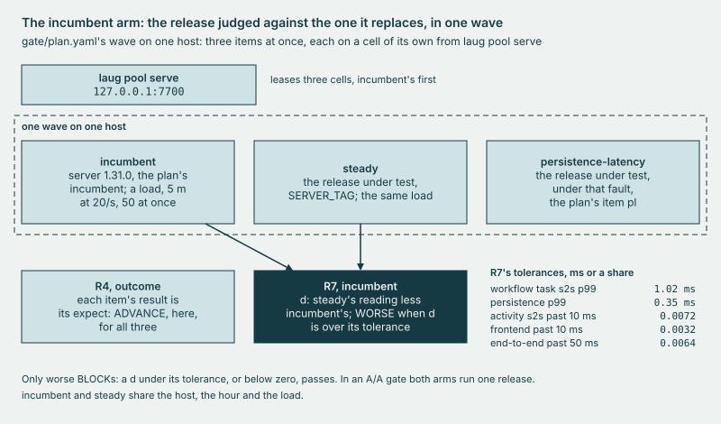

# gate

The release **gate**: its plans, the scripts that run it, the changes it must catch, and its committed runs.

## Why

Without the gate, a release is judged by fixed limits alone, and a release can read worse than the one it replaces
while every limit holds. So the gate runs both at once on one host, each on a fresh cell under the same load, and a
rule compares them reading by reading. The verdict is a function of the run's directory alone, so a committed run can
be judged again to the same bytes.



*One wave on one host: the incumbent, the release under load, the release under a fault, each on a cell of its own.*

## Use

```sh
bin/laug gate run 1.31.0 -fake
bin/laug gate open <gate id>
bin/laug gate rejudge -all
```

The first runs a whole gate on fakes, with no Docker; on the lab host, drop `-fake`. The second prints a run's verdict
and where its files are; the third judges every committed run again and compares the bytes.
[Runbook 4](../docs/runbooks/4-gate.md) and [runbook 5](../docs/runbooks/5-rejudge.md) walk them.

## Extend

- **A plan**: `gate/plan.yaml` is the plan `bin/laug gate run <tag>` runs, its items at once, each a load or a fault
  raun on a cell of its own, with its expect. Another plan is a file under `gate/plans/`, which
  `bin/laug gate run <tag> -plan <file>` runs. Preflight refuses a plan with any problem and names each one, and
  `make harness-test` holds that check.
- **A control**: a change the gate must catch, a diff under `gate/controls/` whose first line says what it must make
  the gate do, and its row in `cmd/laug/gatecontrol.go`. `TestGateControls` holds the two together, and
  `bin/laug gate control -name <name> -fake` runs it on fakes.
- **A host type**: a threshold set measured on that type. Preflight refuses a host whose declared type, vCPU or memory
  is not the set's, and R6 checks the host again in the verdict.
  [load/baseline.md](../load/baseline.md#a-set-for-a-new-host-type) walks it.
- **A set of gate ids**: a file under `gate/sets/`, `<kind>-<label>.txt`, for one calibration, validation or
  control, or for the warm-ups. Each id follows a comment that names the result file lines recording it. `make docs`
  reads every set and stops on one it cannot parse.

[DESIGN, Release gate](../docs/DESIGN.md#7-release-gate) is the design these follow: the rules R1 to R7, the class a
BLOCK takes and the warm-up rule.

## Evidence

[CAPABILITIES, The release gate](../docs/CAPABILITIES.md#the-release-gate); the runs in [`gate/results/`](results/).
