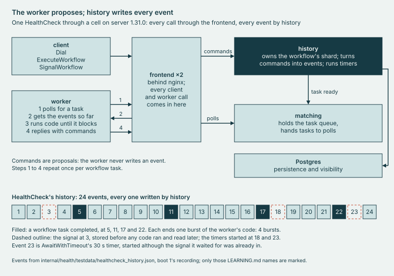

# internal/health

The **HealthCheck** workflow, which a cell must round-trip before it counts as healthy, and the replay tests that hold
its code to a history recorded on a real cell.

## Why

A cell can answer `temporal operator cluster health` and still fail its first workflow. So laug counts a cell healthy
only once HealthCheck completes on it, through frontend, matching and history: two activities of different types, a
durable timer, then a signal. Replay, which `make test-go` runs with no server, proves only that the code is
deterministic against the recorded history, and nothing about the cell (`replay_test.go`).



*The worker proposes commands and history writes every event: the history the replay tests feed back to the code.*

## Use

```sh
bin/laug health check
bin/laug health record
bin/laug health replay
```

The first runs one round trip on the cell at `127.0.0.1:7233`, or the one `-address` names. It starts a worker in
laug's own process, then the workflow; it sends the signal, waits for the result and finds the run in visibility.
`bin/laug cell health` and the pool's backends run it before they call a cell healthy. The second, bare, writes nothing
and says what `-overwrite-fixture` would write over the fixture; the third runs the replay tests with no server.
`bin/laug help health` lists the loop and the timer too, and `cmd/laug/doc.go` says how each verb exits.

## Extend

- **A change to HealthCheck.** Edit `health.go`, then run `bin/laug health replay`. A new duration, input, option or
  result replays clean; a change to which commands run, or their order, fails with `TMPRL1100`, as `TestReplayChanges`
  (`changes_test.go`) holds change by change. Then `bin/laug health record -overwrite-fixture` records the fixture again
  on a cell, so it keeps describing the code (`replay_test.go`). After a change to the commands, change the copies of
  HealthCheck in `changes_test.go` and `replay_test.go` to match, and the event and activity ids in the errors
  `changes_test.go` expects. [LEARNING, The server writes every event](../../docs/LEARNING.md#stop-1) and its figure's
  spec, `docs/img/src/healthcheck-path.txt`, describe this code and this fixture too.
- **The tests.** `TestReplayHealthCheck` replays the fixture, `testdata/healthcheck_history.json`, and
  `TestReplayDetectsSwappedActivities` holds that a build with `Echo` and `Sum` swapped fails on it with `TMPRL1100`
  (`replay_test.go`). `bin/laug health replay <file>` runs the replay tests on another history, one from a cell of
  another release say, in place of the fixture.
- **A role.** A role runs in laug's own process, as `CheckMain` (`check.go`) and `TimerMain` (`timer.go`) do. A new
  one needs its main here, its entry in `healthRoles` and its verb in `cmd/laug/health.go`, and the verb's row in
  `cmd/laug/main.go`, which `TestTableRules` holds. Its rows in `TestMainsTakeTheirFlags` (`mains_test.go`) hold that it
  refuses a bad flag before it dials. Of cmd/laug's files, only `health.go` and `orchestrator.go` import a package that
  links the SDK (`TestSDKFiles`).

[LEARNING, A deploy is a replay](../../docs/LEARNING.md#stop-2) walks what replay checks and what it does not.
[DESIGN, History shards](../../docs/DESIGN.md#41-history-shards) says why a cell is warm only once HealthCheck passes.

## Evidence

[CAPABILITIES, Replay](../../docs/CAPABILITIES.md#replay); the recording, `cells/results/2026-10-23-boot1.txt:289-296`.
