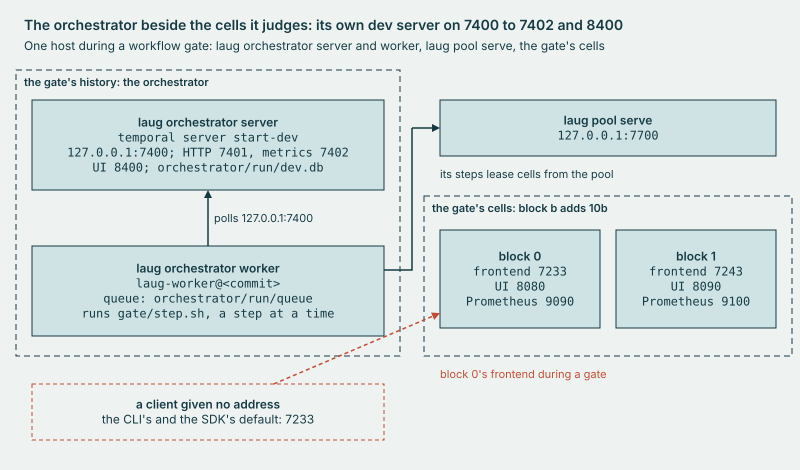

# internal/orchestrator

The **orchestrator** runs laug's gate as workflow Gate, on a Temporal dev server of its own and one worker per checkout.

## Why

Without it, a gate is one bash process, and a killed one leaves its processes, its pool and its lock behind. Here
workflow Gate owns the order of the steps, the waits, the cancel and the recovery, so the next worker replays an open
gate and adopts the steps still running. Since a workflow cannot own a process, bash still runs each step and writes
every file the judge reads, with the workflow or without it.

<!-- source: SDK v1.49.0 internal/grpc_dialer.go:42 -->

*The gate's own Temporal runs beside the cells it judges, on ports of its own.*

## Use

```sh
bin/laug orchestrator server       # run the orchestrator's own dev server
bin/laug orchestrator worker       # run this checkout's worker for workflow Gate
bin/laug gate run <tag> -workflow  # judge a server release as workflow Gate
```

[Runbook 4](../../docs/runbooks/4-gate.md), As a workflow, walks a gate this way. `bin/laug help gate` lists the verbs
that read, cancel and stop a workflow gate.

## Extend

- **A step.** A new step is its lines in `gate/run.sh`, their copy as a `gate/step.sh` verb under a
  `# run.sh:N-M, verbatim` head, its case in `stepKey` (`internal/orchestrator/steps.go`) and its call in
  `internal/orchestrator/gate.go`. New lines in `gate/run.sh` shift the lines below them, so the same commit updates
  each head that names a shifted line and the line count `make harness-test` pins for run.sh. Gate schedules the step as
  activity type `Step`, its id the step's name, so a build that reorders the steps fails replay.
- **An activity.** A Gate activity is an exported method of `GateActivities` (`internal/orchestrator/steps.go`), which
  the worker registers (`internal/orchestrator/worker.go`).
- **The tests.** `make harness-test` checks each verbatim copy in `gate/step.sh` against `gate/run.sh`, byte for byte.
  `TestGateMatchesRunSh` (`internal/orchestrator/parity_test.go`) runs `Gate` and `gate/run.sh` case by case on the
  fake gate and holds both to one signature. `TestGateRunsEveryStepInOrder` holds the order on fakes, and a new step
  goes into each `wantOrder` line in `internal/orchestrator/gate_test.go` whose path runs it. `TestReplayGateHistories`,
  in `make test-go`, replays each fixture named in `internal/orchestrator/replay_test.go` and fails when Gate's commands
  change. `TestReplayCatchesAnotherOrder` moves the barrier before the last lease and sees replay fail. Gate branches on
  no input field but the gate id, and replay reads no plan, so a history recorded on one plan replays on another.
- **A new history.** After a change to Gate's commands, record each fixture again from a finished gate with
  `bin/laug orchestrator record <gate id> <name> -overwrite-fixture`; `real` needs a gate on real cells. Then cut
  `advance-cut.json` again from the new `advance.json`, as `TestReplayCatchesEarlyReturn` says.
- **Versioning.** Gate has no `workflow.GetVersion` branch. Before it polls, the worker replays every open gate on its
  queue on this build and refuses on a mismatch: a replay check at deploy time, not Worker Versioning.
- **A cancel.** Gate returns a nil error on every path, so a cancel ends the workflow Completed, with the cancel in its
  result. Before the judge, that result holds the stop path's trap verdict; from the judge on, the judge's own.

No runbook walks a change to Gate; the failing replay test says to record the history again.
[DESIGN, Orchestration on Temporal](../../docs/DESIGN.md#8-orchestration-on-temporal) is the design these follow.

## Evidence

[CAPABILITIES, The durable gate](../../docs/CAPABILITIES.md#the-durable-gate), and the records under `cells/results/`.
