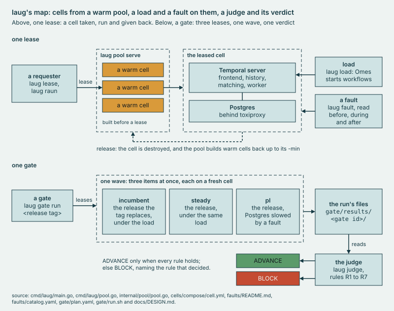

# internal/pool

The warm **pool**: cells built and checked healthy before anyone asks, leased, then destroyed on release or at the TTL.

## Why

Without a warm pool, each raun waits for a cell to be created and to pass HealthCheck before its load can start. So the
pool builds cells ahead, each on a port block of its own, and destroys a released cell rather than hand it on. Every
backend but the fake one is a script, so one pool drives compose projects and Firecracker microVMs.



*Above, the pool's part: cells built warm before a lease, one handed over, and the pool built back up after a release.*

## Use

```sh
bin/laug pool serve -backend compose
bin/laug pool status
bin/laug pool down
```

The first keeps compose cells warm on `127.0.0.1:7700`; bare, it runs the fake backend, which starts nothing, and
`-backend firecracker` runs microVM cells as root. A stop destroys no cell (`TestServeStopsWithinGrace`). The second
prints a row a cell, in one of four states. The third, bare, lists what would go, with counts; `-remove-cells` stops the
pool and removes every pool cell on this host, a stuck one too, and with `-backend firecracker` a microVM pool's.

| State | What |
| --- | --- |
| `warm` | built and healthy, waiting for a lease |
| `leased` | held by its requester until release or expiry |
| `busy` | being created, reset or destroyed |
| `stuck` | a destroy failed or timed out: a release's, or the one after a failed create or a failed reset |

A stuck cell keeps its block and its slot in `-max` (`TestFailedCreateAndDestroyKeepCellStuck`), and one with a
requester keeps its quota place. The reaper retries its destroy, one try at a time, and logs a failed try when its count
is a power of two. Once one succeeds, the cell goes and a replenish starts (`TestStuckCellDestroyIsRetried`).

`laug pool serve` answers this API on its `-listen` address. `internal/poolapi` is its Go client, which laug's verbs
use, and `laug lease` keeps the lease it gets in `.last-lease.json` for the load and fault scripts.

| Method and path | Body | Returns |
| --- | --- | --- |
| `POST /lease` | `{"ttl_seconds": 600, "requester": "ci", "server_tag": "1.32.1"}` | the lease |
| `POST /release` | `{"id": "..."}` | `{"released": "..."}`, or `502` with the destroy's error (`TestFailedReleaseKeepsCellAndBlock`) |
| `POST /reset` | `{"id": "..."}` | the lease: a fresh cell, the same id and `expires_at` (`TestResetKeepsLeaseIDAndBlock`) |
| `POST /vmfault` | `{"id": "...", "kind": "drive", "body": {...}}` | `{"ok": true}` |
| `GET /status` | none | `min_warm`, `max_cells`, `quota`, `max_lease` and `cells`, each cell in a lease's keys (`statusView` in `pool.go`) |
| `GET /healthz` | none | `ok` |

Before any route, a request gets `403` unless its Host header is `localhost` or a loopback IP, with a port or without
(`TestForeignHostIs403`, `TestLoopbackNames`). One with a body gets `415` unless its Content-Type is
`application/json`, a parameter such as charset allowed (`TestLeaseAsTextPlainIs415`, `TestContentTypes`). A refusal,
from these checks or a route, is one line, `{"error": "..."}`.

A lease holds `id`, `address`, `ui`, `grafana`, `prometheus`, `toxiproxy`, `project`, `dynconfig`, `ssh`,
`server_tag`, `backend`, `firecracker_version`, `cache_type`, `block`, `state`, `requester`, `leased_at` and
`expires_at`. `backend` is compose, firecracker or fake; `firecracker_version` and `cache_type` are a microVM cell's,
from its snapshot; the two times are in UTC (`TestLeaseTimesAreUTC`). A lease that names a `server_tag` takes a warm
cell of that tag, or else one built with it (`TestLeaseTakesWarmCellOfItsTag`). A tag that is not x.y.z gets `400`
before any cell is reserved (`TestLeaseBadTagIs400`). `/release`, `/reset` and `/vmfault` answer `404` for an unknown
id (`TestReleaseDestroysAndFreesBlock`, `TestResetOfCellNotLeased`, `TestVMFault`).

`/vmfault` hands a leased cell's VMM a change, and the cell stays leased: the backend runs `vmfault <id> <kind> <body>`,
the body as compact JSON. `faults/run.sh` sends one with curl for the disk-slow fault. `cells/backend-firecracker.sh`
takes kind `drive` with a body of `{"drive_id": "rootfs", "rate_limiter": {...}}` and puts that rate limiter on
`rootfs`, the cell's one drive. It refuses any other kind or body, and the compose backend has no such verb; either
error comes back as `502` with the script's line (`TestVMFault`). A request with no `id`, a `kind` other than lowercase
letters, or a `body` that is not a JSON object gets `400` (`TestVMFault`).

## Extend

- **A backend**: a script run as `<script> create|destroy|health <id>`, with `LAUG_BLOCK` and `SERVER_TAG`, the lease's
  or the pool's, for the cell's life (`TestScriptEnvAndStderr`, `TestLeaseTagReachesBackend`). It publishes its ports
  from that block alone, and its destroy succeeds only once those ports are free, since the pool frees the block on that
  success. [cells](../../cells/README.md#extend) says the rest.
- **A port block**: each cell holds a block of its own (`TestBlocksNeverCollideAndPoolFullIsRefused`), through a reset
  too (`TestResetKeepsLeaseIDAndBlock`), until a destroy succeeds. `bin/laug pool serve` refuses a `-max` past the
  blocks whose frontend port stays below the default ports of the orchestrator's dev server and of `pool serve`. Its
  error names the range. A microVM cell publishes no host port, so `-backend firecracker` is exempt (`TestPoolBlocks`).
- **A route**, in `newMux`: `/lease` and `/reset` answer `502` with the backend's text when a create fails or a health
  check never passes (`TestBackendFailureIs502`). `409` is the pool's refusal: a quota, a full pool, a cell not leased.
  `/lease` answers `400` to a `ttl_seconds` of zero or less, or none, before it reserves a cell, and caps one over
  `-max-lease` at `-max-lease` (`TestLeaseTTLOfZeroOrLessIs400`, `TestLeaseTTLOverMaxLeaseGetsMaxLease`).
- **A guardrail**: code in `pool.go` with a test beside it. [DESIGN](../../docs/DESIGN.md#3-proposal) lists the TTL and
  the quota. Another counts a cold lease's slot in its quota while the cell builds (`TestQuotaCountsCellsBeingBuilt`).

## Evidence

[CAPABILITIES, The pool](../../docs/CAPABILITIES.md#the-pool); the record, `cells/results/2026-10-23-boot1.txt:360-398`.
